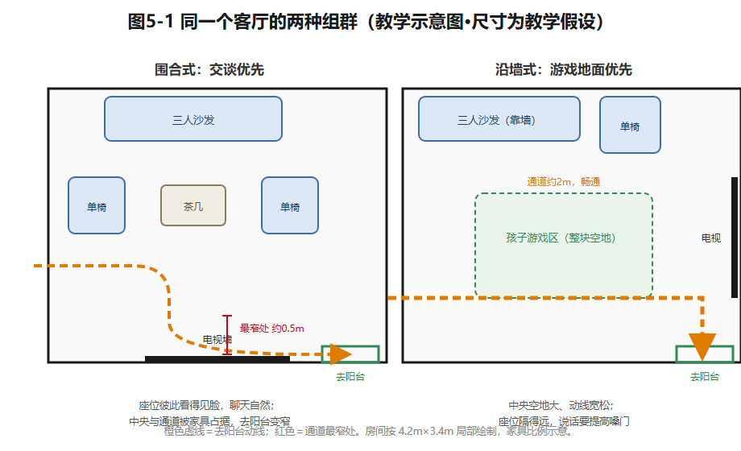
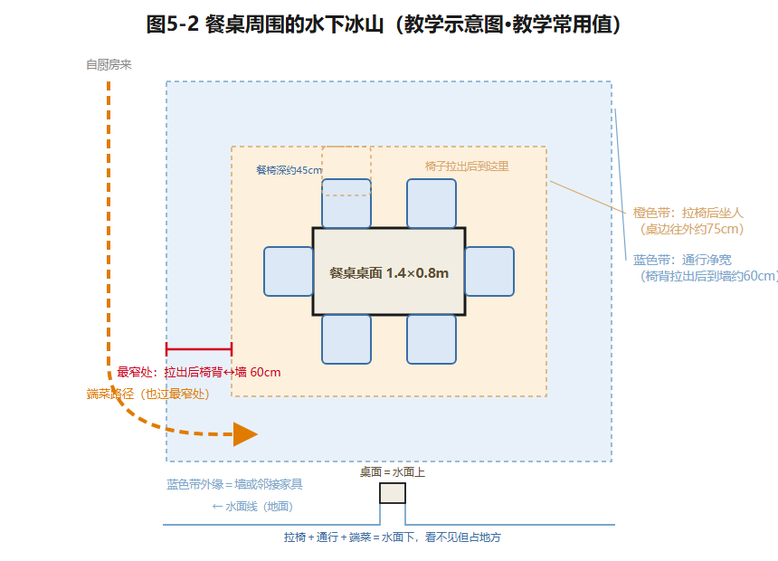
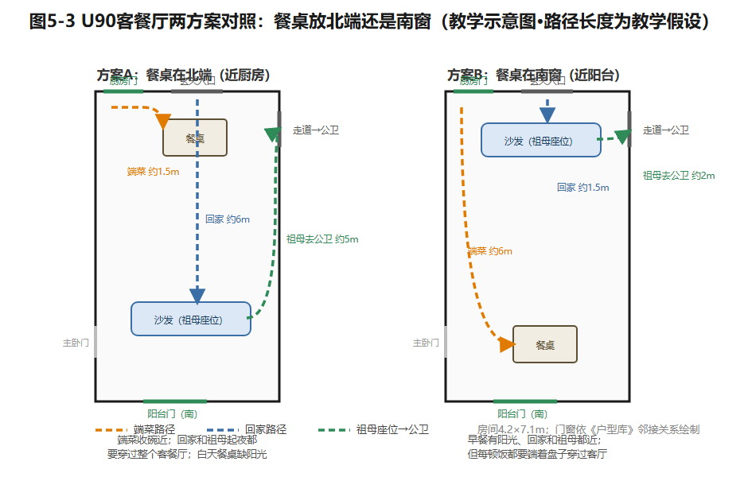

## 第5章 客厅、餐厅与公共生活空间

晚饭后八点，青枫里401客厅的灯亮着，却没有人。

沈先生回书房开会去了，女儿在自己房间搭积木，沈太太占着餐桌备课，祖母一个人坐在沙发上，电视开着，声音很小——她其实没在看。沙发是新的，电视是新的，落地灯也好看。可这个四十多平方米的客餐厅，一天里最热闹的时刻是吃饭，饭后就空了。

你家里可能也有这样一张"谁都不坐"的沙发。问题通常不出在沙发，而出在**这个空间被安排成了什么**。这一章我们就从沈家的客厅开始，看看住宅里的公共空间到底为谁服务、怎么服务。

### 5.1 客厅是干什么用的

先做一个小实验：拿一张纸，写下你家客厅里发生过的所有活动。别只写"看电视"。

写出来大概会吓你一跳：吃饭、聊天、招待客人、孩子摊开玩具、织毛衣、刷手机、午睡、包饺子前的"工作台"、熨衣服的临时场地……客厅（加上餐厅）是全家人共用的地方，一个人在家时它是整个家的中心，过年时它要装下十几个人。

可是很多客厅只按一件事设计：看电视。电视挂在最长的那面墙正中，沙发正对电视，中间一个茶几——完毕。这种摆法看节目很舒服，但你想跟家人说话时，就得扭着脖子横着聊。研究者观察到一个长期的转变：几十年前，全家人围着客厅里唯一的一台电视；现在屏幕越来越便宜，人手一个，观看反而散到了各自的房间里（这一趋势有伦敦政治经济学院的家庭媒体研究支持，见本章尾注）。也就是说，"电视中心"只是某个年代的生活方式，不是客厅的天性。

那客厅按什么设计？按**人和活动**。给你看沈家的清单是怎么列的：

- **祖母**：白天要一个能晒着太阳看书、又抬眼就能看见家人的座位——她在家时间最长，客厅几乎就是她的整个白天；
- **女儿**（6岁）：要一块能铺开积木和画材的地面，玩完能自己收——收纳矮一点，她才够得着；
- **沈先生和沈太太**：晚上要能舒服地坐着说说话；偶尔，还得有一位家长在这里临时加班。

你看，这张清单里没有一件家具，全是"谁在做什么"。**先有人和活动，才有家具**——这是本章的第一条道理，请记住它。

### 5.2 家具组群：沙发怎么摆，人就怎么坐

家具不是一件一件买的，是一组一组"围"出来的。

想象三个座位：一张三人沙发，加两把单人椅。把它们摆成"U"形、开口朝着茶几——坐在里面的人自然而然会聊天，因为彼此看得见脸。同样的三件家具换成"一"字形排开、全都面向电视——聊天就变成了"对观众讲话"。**家具怎么摆，人就怎么相处**：围成一圈，大家自然面对面说话；排成一排，大家只能一起看屏幕。

但围合是有代价的。沈家客厅宽4.2米，沙发、单椅、茶几一围，中间还留着通道去阳台吗？沈太太量过：沙发往前挪三十公分，去阳台就得侧着身子挤过去。反过来，把沙发和椅子都推到墙边、中间留整块空地——孩子有了游戏场，可座位之间隔得太远，说话得提高嗓门。

两种摆法都对，看这个家**更常发生什么**。这就是为什么本书让你画两张图：一张"日常状态"（工作日晚上，三口人各自在干嘛），一张"来客状态"（周末来了四五个客人）。家具按日常摆，客人来了挪椅子——挪过去的椅子放哪、坐完归位到哪，图上都要画出来。**凡是说不清"谁去挪、怎么挪"的弹性，都是纸面上的弹性。**

再说电视。屏幕放哪面墙，不该由"哪面墙最长"决定，而要检查三件事：主要座位看得舒不舒服（视距按你家电视的实际尺寸核一核，别背一句"最佳距离"到处套）；窗户会不会在屏幕上反光；以及——最容易被忘掉的——不放电视的那面墙，留给了谁。

最后是柜子。低柜（电视柜、边柜）矮，不挡光、不挡视线，还能顺手收孩子的玩具；高柜装得多，但会吃掉窗户进来的光，让房间显得闷。沈家的解法是：靠走廊一侧做高柜收大件，靠窗一侧只放矮柜——容量和光线各留了一条活路。

*图5-1 同一个客厅的两种组群：围合式（交谈优先）与沿墙式（游戏地面优先），叠加去阳台动线与最窄处。教学示意图。*

### 5.3 餐桌：这个家真正的多面手

如果说客厅常被高估，餐桌就常被低估。

表面看，餐桌就是吃饭的地方。实际观察一周你会发现：女儿在餐桌上写作业，沈太太在餐桌上备课、改卷，周末全家在餐桌上包饺子，来客人时它是茶台，网购的大件拆封也在餐桌上——**餐桌是一个家里使用频率最高的"工作台"**，只是每天变换着工种。

所以餐桌的尺寸不能只按"几口人吃饭"算。要算两笔账：

第一笔，**吃饭的账**。按常住人口算长宽——沈家平日三口人吃饭，祖母长住或来客时才坐满，一张1.4米的长桌平日够用，来客加折叠椅。别一步到位买超大桌：为一年两次的聚餐，天天损失一条通道，不划算。

第二笔，**拉椅子的账**。这笔账大多数效果图都不画：椅子拉开坐人，大约需要桌边往外75厘米；人要能从坐着的椅子后面通过，再加60厘米左右（这些是课堂常用值，帮助你想象量级；真买桌子时用你家椅子实测）。**桌面尺寸只是冰山露出水面的部分，水面下的"使用净空"才决定这个餐厅好不好用。**顺带说第3章的一个老朋友：最窄处决定全程——餐厅通道也一样。

餐桌还带出一个厨房问题：开放还是封闭？这一对矛盾你在装修节目里肯定见过。封闭厨房挡油烟挡噪声，但做饭的人被关在小房间里，跟家人隔着一堵墙；开放厨房热热闹闹，可中式爆炒的油烟是真实的。其实这不是二选一，而是一条谱带：全封闭——玻璃移门半开——开个传菜口——全开放。沈家喜欢烘焙、少爆炒，谱带可以往开放端挪；每天炒辣椒的家庭，往封闭端挪。另外提醒一句：U90厨房靠餐厅那面墙如果属于承重固定项，"开个传菜口"就得先打问号——**动念头之前，先查墙的户口**（第11章专门讲怎么查）。

沈家还有一个具体选择：餐桌放北端还是南端？放北端、挨着厨房，端菜收碗近，但离窗户远，白天光线一般；放到南窗边，早餐有阳光，可每顿饭都要端着盘子穿过半个客厅。你在本章末的任务卡里会亲自算这笔账。

*图5-2 餐桌周围的水下冰山：从桌边向外依次是"拉椅后坐人区"与"通行区"，端菜路径也要经过最窄处。教学常用值。*

### 5.4 进门的第一分钟，决定这个家顺不顺

下雨天回家，你一手拎着菜，胳膊上挂着湿伞，钥匙咬在嘴里——这时候你需要的不是一面漂亮的玄关墙，而是一个能让你在三秒内把东西全部放下的地方。湿伞、快递、书包、外套、钥匙，这些东西要是没有明确的"停车位"，它们就会一路停到餐桌上、沙发上，最后这个家看起来永远像刚搬进来。

玄关要回答的其实是两个问题：**东西放哪，视线往哪**。第一个问题好理解；第二个经常被忘记——大门一开，来访客人的视线也进来了。如果从门口能直接望见卧室门，或者看见餐桌上一摊还没收的备课资料，家的私密感就漏掉了。但挡视线不等于砌墙：一个转向、一组矮柜、一盏暖光，甚至地面从瓷砖换成木地板的那条分界线，都在告诉眼睛"从这里开始，是家的里面了"。

玄关最容易犯的错，是柜子做太深。U90的玄关柜如果做到60厘米深，容量是大了，可早晨一家三口同时出门，蹲下换鞋的、弯腰拿包的、开门的，全挤在剩下的窄条里互相绊脚。反过来全做成敞开的，鞋和包是方便了，它们会慢慢"侵略"进客厅。怎么定深浅？画四个动作的"占地范围"再叠加：开门（门扇扫过的弧）、落物（手里东西临时放哪）、换鞋（蹲下时人占多大）、取包。四个圈叠完，剩下的地方才是柜子的合法领地。

别忘了玄关还是两条路的起点：买菜回家的路（玄关→厨房，袋子里的菜别在客厅绕一圈）和客人的路（玄关→客厅→公共卫生间，别路过卧室门口）。这两条路，本章任务卡里也要画。

*图5-3 U90客餐厅两方案对照：餐桌北端（近厨房）与南窗各画一版，三条路径三种颜色——端菜、回家、祖母座位到公卫。路径长度为教学假设。*

### 5.5 同处一室，各做各事

这一节讲客厅和餐厅的最高境界：**一家人待在同一个房间，各自做不同的事，还互不打扰**。祖母看书，女儿搭积木，沈太太整理资料——不需要四个房间，需要的是"看得见彼此、听得见彼此，但互不搅局"的安排。

做法是给每项活动一块**可辨认的地盘**：一块地毯就算孩子的游戏区，书架背后就是安静的阅读角。但地盘不能圈过头——用地毯和矮书架划分区域，光线、视线和走路的路还得穿得过去；如果划分的代价是绕路和难打扫，这个划分就要重新谈。

近年流行一个词叫"去客厅化"：撤掉"沙发+茶几+电视"老三样，把客厅改成孩子的活动场加家庭大书桌。这个思路对有些家庭确实好——比如以孩子和餐桌为中心的年轻三口之家。但把"客厅"改名叫"家庭活动室"，一句话就够了；客厅里的位置归谁用，是另一回事。比如沈家：要是撤掉大沙发，白天在家时间最长的祖母，可能连一个能舒服坐着、又看得见家人的位子都没有，只好整天待在卧室里。所以，改名字不费劲，难的是重新安排"谁在哪儿活动"——这得先弄清楚这个家里到底谁需要什么（还记得第2章的家庭画像吗？它在这里用上了）。

### 想一想

1.（选择）客厅里"沙发+单椅围合成U形"最主要的收益是——A. 省面积；B. 让坐着的人彼此看得见、便于交谈；C. 电视看得更清楚。
2.（选择）餐桌买多大，最不该依据的是——A. 常住人数；B. 椅子拉出与通行需要的净空；C. 邻居家买的多大。
3.（简答）你家或宿舍进门处，东西放哪、视线往哪？各用一个具体的问题描述它的现状，并提出一条最小改动建议。

### 实践任务卡：给沈家客厅定方案

**任务**：在U90客餐厅（4.2m×7.1m，尺寸与固定条件见《户型库》）里完成两版"起居＋就餐"组合。

**要求**：①每版画"日常状态"与"来客状态"两张图，标出祖母、女儿、夫妇的常用座位；②画出三条路径：厨房端菜到餐桌、入户到起居座位、祖母从座位到公共卫生间；③检查餐椅拉出后的通道最窄处；④写300字说明：两版各把最好的位置给了谁、牺牲了什么。
**交互形式（线上实现，教材不绑定平台）**：家具可拖拽组合、"日常/来客"状态一键切换、三条路径自动叠加显示最窄处。

### 本章小结

客厅和餐厅不是"待客的门面"，而是一个家白天和傍晚真正的发动机。设计它，先列"谁在做什么"，再让家具围出交谈、让地面留出游戏、让餐桌当好多面手；玄关管好进门一分钟的两个问题——东西放哪、视线往哪；公共空间的最高境界是一家人同处一室、各得其所。

请带走两句话：**先有人和活动，才有家具。桌面尺寸只是冰山露出水面的部分，水面下的净空才决定好不好用。**

---

*本章尾注·资料来源与核验记录*

| 素材 | 核验状态 | 来源 |
|---|---|---|
| 家庭观看从共享客厅电视转向个人化/卧室化媒体的长期趋势 | 已核实线索（现象层面） | 伦敦政治经济学院（LSE）研究文库：From Family Television to Bedroom Culture；Half a Century of Television in the Lives of Our Children（2026-10检索）；具体数据未引入 |
| "去客厅化"讨论 | 教学转述（媒体流行概念） | 中文家居媒体常见提法；本书以家庭行为证据裁决 |
| 餐厨封闭—半开放—开放谱系利弊 | 教学转述（专业通行分析） | 住宅设计原理通行表述；按U90情境重组 |
| 本章尺寸（拉椅75cm、通行60cm等） | 教学常用值 | 课堂推理值；正式使用前以实测与现行规范核验 |
| U90客餐厅4.2×7.1m、玄关与厨房关系、沈家活动设定 | 教学假设 | 本书《住宅贯穿案例与户型库》 |
