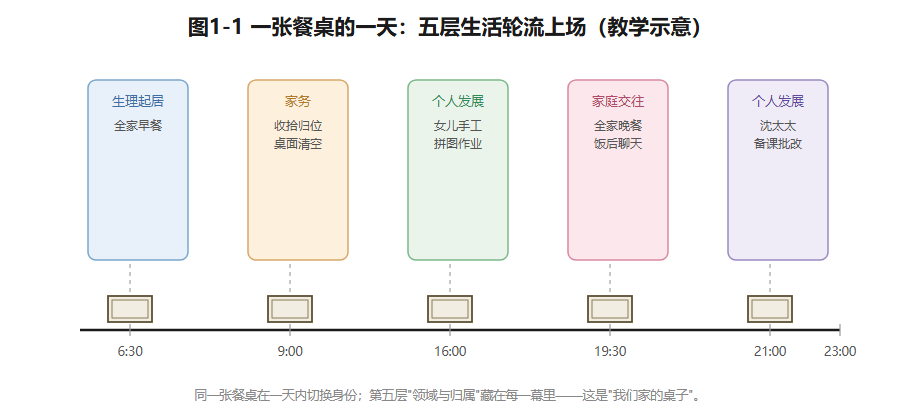
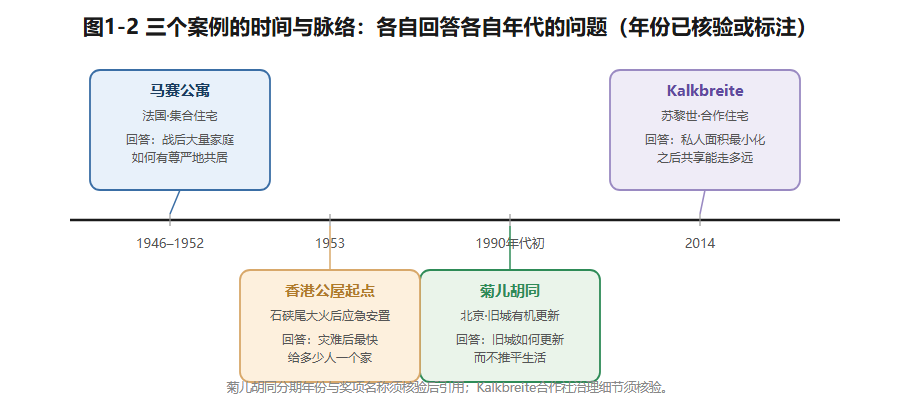
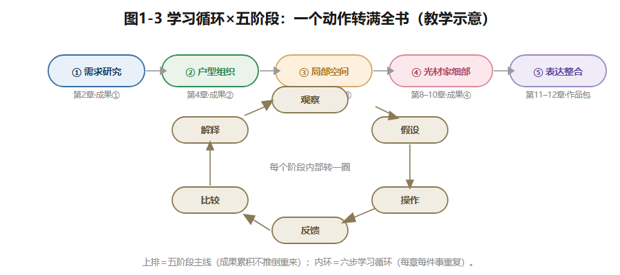

## 第1章 住宅室内空间设计概论

搬进新居满一个月的那个晚上，这个三口之家发现了三件事。

玄关的鞋溢到了走道上——鞋柜是按"每人三双"算的，可换季的鞋、运动的鞋、客用的拖鞋很快挤破了容量。餐桌一角立起了台灯和插线板，成了常设办公桌——因为家里唯一的书桌，总被孩子的作业占着。周末来了三位客人，三人沙发之外竟然无处落座，最后客人坐去了儿童房的小凳。

当初效果图上，每件家具都恰到好处。可镜头之外的生活，处处溢出。问题多半不出在施工和材料，而出在设计的起点：**把住宅当成"一套待装修的房子"，而不是"一段将要发生的生活"**。设计要从理解居住开始，不是从风格开始——这是全书的第一块基石。本章给你三件工具：居住生活的层次、设计的层次、分析案例的框架。

### 1.1 先翻译，再设计

"三室两厅两卫"——这是房间的**名词清单**。可居住是由**动词**构成的：睡觉、做饭、吃饭、洗澡、辅导作业、开视频会、晾衣服、招待客人。

名词相同的两套房子，动词清单可以完全不同，正确答案也就完全不同。同样是"次卧"：给六岁的女儿用，你要回答游戏垫铺在哪、书桌几年后从哪里"长"出来；给长住的祖母用，你要回答床到卫生间有多远、半夜起来的路有没有光、地面滑不滑。名词一样，动词清单几乎不重叠。所以，拿到任何住宅设计问题，第一件事是**把户型名词翻译成这个家的动词清单**。这个动作贯穿全书，本章作业就有第一次练习。

住宅到底在满足什么？往前追，它的原点是**庇护**：遮风挡雨、安全睡眠。当庇护成了默认条件，住宅往上长出了心理和文化的枝叶：一块"由我们做主"的领域；一种"我们是谁"的身份讲述；一个装记忆的容器——门框上的身高刻度、餐厅墙上的照片。

香港的公屋史几乎就是这段话的实物展览（已核实线索：香港房屋委员会官方"公屋发展历程"）：1953年石硖尾大火之后，第一代徙置大厦用极小的单位大批量安置灾民，早期连独立厨卫都没有——那是"庇护"阶段。此后几十年，公屋一步步补上独立厨房卫生间、居室分隔、社区设施——"生活"一层层叠了上去。从"有地方住"到"过想要的生活"，这条线也是你自己做设计时的检查顺序。

为了让"生活"变成可设计的东西，本课程把居住生活拆成五层：

1. **生理起居**——睡觉、吃饭、洗漱、如厕，每天的必需，决定空间的底线；
2. **家务**——做饭、清洗、晾晒、收纳、打扫，决定设备和储藏体系；
3. **家庭交往**——一起吃饭、说话、休闲，决定公共空间的品质；
4. **个人发展**——学习、工作、爱好，决定安静角落的存在方式；
5. **领域与归属**——私密控制、领域标记、家的认同，决定边界和入口。

这五层不是五张房间表，而是**叠在同一个空间上的五重身份**。一张餐桌，一天之内可以是家务中转台、全家聊天的圆心、孩子的作业桌、妈妈的备课台。层与层之间还会打架：个人发展要安静，家庭交往要热闹，常常争同一时段的同一块地方。承认这种争夺、管理这种争夺，正是"室内设计"和"摆家具"的分界线。

*图1-1 一张餐桌的一天：五层生活轮流上场。教学示意。*

### 1.2 设计在四个层次上展开

住宅室内设计的工作对象，可以概括成四层，一般按这个顺序决策：

**空间组织**（功能分区、房间关系、动线）→ **界面**（地面墙面顶面的材料构造、隔断门窗）→ **设备**（水、电、暖、灯、网）→ **陈设**（家具、织物、灯具、绿植、收纳）。

上层为下层立条件。拿"开放厨房"来说：它首先是**空间组织**层的决定；一旦成立，界面层的隔断取消了，设备层的排烟电位要跟上，陈设层的岛台也得重新想。层次也会反向倒逼：嵌入式蒸烤箱的散热净深不够（设备层），可能逼着橱柜乃至隔墙（界面层）调整。四层是循环对话，不是单行道。

开放餐厨还是这一行最典型的价值取舍。打通厨房和餐客厅，收益是**社交的**：做饭的人不再被隔离在灶台前，空间显大，光线互通。代价是**物理的**：油烟扩散、噪声串味、立面暴露后的打理。不存在普适答案：以轻食为主、通风好的家庭，收益远大于代价；天天爆炒的家庭可能正相反。同一户型，两个家庭做出相反决定，**可以都正确**。设计者的职责是把收益和代价摆上桌面，帮这个家按自己的行为结构选，而不是替所有人下结论。

还要说清边界。室内设计在建筑交付的骨架内工作：结构墙、门窗洞口、卫生间降板、烟道管井，通常动不得——U90的"固定项"清单就是这类边界的课程版（见1.6）。设计师对住户负责，把需求翻译成可建、可用、可维护的方案；对底线负责——凡涉及结构拆改、燃气、防水、防火、电气安全的事项，识别风险、移交专业机构，本书提到国家标准时一律"按现行标准核验"，不作合规结论；对协同负责——在住户、施工方、材料商之间管好预期、进度和预算。记住一句话：**效果图是意图，图纸和技术文件才是承诺。**

### 1.3 认识住宅的类型

**先看楼栋。**教学常用口径：1–3层低层，4–6层多层，7–9层中高层，10层以上高层（工程界定以现行标准为准）。楼栋形态决定户型的先天条件：多层板楼一梯两户，常能南北通透、明厨明卫；高层塔楼围着核心筒转，朝向分散、公摊也大。拿到项目先弄清楼栋形态——它决定你手里有多少采光、通风的牌。

**再看套内组织。**平层：所有功能同一层，最常见，也是本课程的主对象。跃层：套内两层、户内楼梯联系，每层功能相对完整。复式：高层高里局部加夹层，夹层从属主层（两者区分是教学常用口径）。开间公寓：一个大空间装下睡眠、起居、烹饪，靠分区和家具而不是隔墙来组织——户型库的U30层高3.9米，正是夹层潜力的教学样本。

**套型与居室数。**套型按卧室数计：一居、两居、三居（教学口径，客厅另算）。但要警惕"三居=三口之家刚好"这种机械对应：两代同住的家庭，三居仍可能紧张——紧张的不是床位，而是作息、私密边界和卫浴错峰需要的空间关系。U90用三居装"三口之家＋季节性长住的祖母"，就是让你亲手处理这种紧张。

**面积与得房率。**三个常用概念：建筑面积（含公摊和墙体）、套内建筑面积、套内使用面积（净面积）。得房率＝套内建筑面积÷建筑面积（教学常用定义），一梯两户板楼通常高于塔楼。本课程和户型库一律用**套内使用面积**：U90约89㎡，课程里叫"约90㎡三居室"，全部房间尺寸是净空间教学假设，面积允许±2%教学误差。看任何户型资料，先问一句：这个数是哪个口径？**口径不清的数字，没法比较。**

### 1.4 好房子的五个词

本课程的价值观是五个词：**适用、安全、经济、绿色、美观**。

**适用**，是方案与真实行为的吻合程度。检验不在图纸上，在第七天的早餐桌上——第2章整章就讲这件事。**安全**是底线思维：结构、防火、燃气、电气、防滑，涉及国家标准的都须核验；设计课教你识别，不替代合规判断。**经济**是全生命周期账：造价之外，维护、能耗、更换都算进去——五金和密封件是最不该省的地方之一（教学经验值）。**绿色**是被动优先：先用朝向、通风、天然采光这些"免费的资源"，再谈设备；耐久就是环保，用二十年的柜子胜过两个用十年的。**美观**，从属于真实生活，不是贴在生活外面的风格皮。

做一个教学例题。同户型、同预算，两种花法——**方案A**：全屋高档石材饰面＋满做造型吊顶；**方案B**：常规环保材料，差额全投给厨房动线、全屋收纳和照明。入住一年，哪家抱怨少？诚实的答案是"看这个家怎么生活"：以轻食外食为主、没有孩子的家，方案A未必吃亏；天天做饭、有学龄儿童的家，方案B大概率胜出。结论不是B对A错，而是——**档次的收益集中在眼睛里，适用的收益分布在每一天的每个动作里。**

效果图呈现的是最佳时刻、最佳机位；居住却是全天候的。所以本课程要求一种日常检验：把方案放进"一周七天的行为脚本"里逐天过——周一早晨的玄关、周三深夜的厨房、周日午后的客厅。第2章的行为日志，就是这件工具的正式版。

### 1.5 怎么读一个优秀案例

初学者读案例，最容易读成"风格赏析"："大气""温馨""高级"——这些词不产生任何可迁移的信息。本课程把案例还原成一条链：**问题—条件—决策—后果**。设计者面对什么家庭、什么限制？做了哪些关键决策？结出了什么果？能回答这条链，案例才是你的；只记住造型，案例只是一张图片。

六步分析框架（每步至少回答一个"为什么"）：

| 步骤 | 看什么 | 至少回答 |
|---|---|---|
| 一 家庭与需求 | 家庭结构、生活方式、文化与制度 | 这是为谁设计的？生活方式怎么写进了平面？ |
| 二 空间组织与动线 | 公私/动静/洁污分区、邻接、动线 | 什么被拉近了？什么被隔开了？代价是什么？ |
| 三 尺度与人体工程 | 关键净尺寸、家具与通行净距 | 这些尺寸支撑了什么行为？放弃了什么？ |
| 四 光 | 朝向与房间、进深与采光、明暗 | 好光给了哪个房间？暗处怎么处置？ |
| 五 材料与色彩 | 触感、耐久、维护、空间感知 | 材料在哪里承担了实际职责？ |
| 六 细部与收纳 | 储物与行为、高度深度与使用者 | 收纳跟着行为走，还是跟着墙面走？ |

用三个真案例走一遍这条链（年份与事实均已核验或标注）。

**马赛公寓（法国，1946–1952）**。勒·柯布西耶对战后住房危机的回答（已核实：法国国家图书馆、马赛旅游局官方页）。多数居住单元是跨两层的复式，几层共用一条内部"街道"，商店在中部楼层，幼儿园和运动场抬上屋顶，尺寸用他自己的人体比例体系"模度"推敲（特征为教学转述，细节以权威建筑史料为准）。用六步看：第一步它接纳了家庭构成的多样性；第二步把街道—商店—学校压进了一栋楼。代价同样清楚：内街的活力，是用入口邻近性和私密性换的。它的集合居住模式搬不进U90这样的商品住宅；**可迁移的是"户内组织与公共层次互相定义"这个关系**。

**菊儿胡同（北京，1990年代初建成，分期年份须核验）**。吴良镛主持的旧城危旧房更新（已核实线索：科普时报、光明日报专题报道），主张"有机更新"：不整体推平，顺着旧城肌理渐进置换。关键决策是把四合院的院落生活翻译成"新四合院"——几层单元楼围出共享院落，每户有明确归属，又共享院子这个交往层次（曾获国际奖项，名称与年份须核验后再引用）。课堂价值在于观察"户内—院落—街巷"三个层次怎么过渡，而不是把传统形象复制进公寓。

**Kalkbreite（苏黎世，2014年8月落成）**。建在有轨电车停车库之上，住宅、商业、办公混合（已核实：苏黎世市政府2014-08-23开放新闻公报），由住房合作社开发运营（治理细节须核验）。它对"家需要多大私人面积"给出一种制度化回答：私人单元偏小、类型多样，洗衣房、客房、工作坊、聚会空间等共享设施规模可观（设施清单为教学转述）。注意边界：它的成立依赖合作社治理与城市政策——**不能从共享设施的照片，直接推断每户更舒适、成本必然更低。**

三个案例分别长在战后重建、旧城更新、合作建房制度里。形态结论不可抄，**推理可以学**——这正是"问题—条件—决策—后果"式阅读的全部价值。

*图1-2 三个案例的时间与脉络：各自回答各自年代的问题。年份已核验或标注须核验。*

### 1.6 这门课怎么走：U90与五阶段

全书骑在一个虚构但完整的案例上：**U90「青枫里2栋1单元401」**——板式小高层一梯两户之东户，四层，南北通透，套内使用面积约89㎡（课程口径"约90㎡"），层高2.8米；南阳台4.2㎡、北生活阳台2.7㎡另计。房间构成（净尺寸，宽×深）：

| 房间 | 净尺寸（m） | 面积（㎡） | 位置与朝向 |
|---|---|---:|---|
| 客餐厅 | 4.2 × 7.1 | 29.8 | 中部，南北贯通；南接观景阳台 |
| 主卧 | 3.6 × 3.85 | 13.9 | 西南角，南向窗；含衣帽区 |
| 主卫 | 1.9 × 2.0 | 3.8 | 主卧内北端（降板区） |
| 儿童房 | 3.2 × 3.0 | 9.6 | 东南角，南向窗 |
| 书房／老人房（双模式） | 2.9 × 3.0 | 8.7 | 东北角，北向窗 |
| 厨房 | 2.8 × 2.25 | 6.3 | 西北角，北向窗，北接生活阳台 |
| 公共卫生间 | 2.0 × 2.2 | 4.4 | 北部中段，紧邻书房以西 |
| 玄关 | 1.5 × 2.0 | 3.0 | 北侧中部入户处 |
| 走道 | — | 9.5 | 中部，联系各房间 |

（楼盘、住户、尺寸均为教学假设，面积允许±2%误差；比例平面图待验证前，一切摆位是待检验的设计假设。）

住在里面的是虚构的沈家：**沈先生**35岁，软件工程师，每周约两天居家办公，要长时间视讯和双屏工位，在乎书房隔声；**沈太太**33岁，中学教师，晚间备课批改，习惯占餐桌一端，爱烘焙，烤箱小家电一堆；**女儿**6岁，游戏、阅读、将来的学习角，东西小、多、换得快；**祖母**68岁，每年长住三到四个月，未来可能常住，膝盖不便、怕摔、怕夜里摸黑，要就近如厕和防滑。注意一个伏笔：公卫紧邻书房（老人房）——第2章"就近如厕"的教学点就埋在这里。

U90还配了一套**固定项与可变项**：外墙外窗与洞口、入户门、两道剪力墙、厨房烟道立管、两个卫生间的降板排水——固定，动不得；儿童房与书房之间的隔墙、衣帽区隔断、公卫内隔断、全部活动家具——可变，随你设计。这套装置的用意是诚实：真实设计永远在约束里做，自由度不来自"什么都能改"，而来自"可变项里你能做多好"。同户型另附三个情境卡（现状、五年后、假想合租），后面章节做弹性练习用。

课程按五个阶段在U90上累积成果：**①需求研究**（第2章）→**②户型与功能组织**（第4章，第3章给尺度工具）→**③局部空间**（第5–7章）→**④光、材料、家具细部**（第8–10章）→**⑤表达与整合**（第11–12章）。每个阶段叠在上一个阶段的成果上，不推倒重来。

最后一件工具是学习循环：**观察—假设—操作—反馈—比较—解释**。观察，记录真实居住现象；假设，提出可检验的设计判断；操作，在图纸上做动作；反馈，用证据回查后果；比较，至少看两案差异；解释，说出取舍理由。在U90上试走一圈：餐桌上常堆着教案作业本（观察）→ 假设"餐桌北端其实是第二工作位，需要专用照明和收纳，而不是更大的桌子"（假设）→ 平面上试排"餐桌端部工位"与"书房第二工位"（操作）→ 用一天作息回查晚餐时段冲不冲突（反馈）→ 比较两案冲突频次与成本（比较）→ 用五层次说明取舍（解释）。这个循环每章每件事重复，直到成为职业习惯。

*图1-3 学习循环×五阶段：上排为成果累积的五阶段主线，内环为六步学习循环。教学示意。*

### 想一想

1.（选择）"三室两厅"属于——A. 动词清单；B. 名词清单；C. 设计任务书。
2.（选择）开放厨房的取舍，最不该作为判断依据的是——A. 这个家怎么做饭；B. 通风条件；C. 当前流行什么风格。
3.（简答）用一句话说出你家（或宿舍）里一处"名词没问题、动词出了问题"的地方，并归到五层次中的某一层。

### 实践任务卡：解剖一个优秀住宅

**任务**：选一个真实建成的住宅案例，用六步框架做完整解剖（**成果⓪**，为第2章研究沈家做铺垫——先见过"别人的好"，再回到"沈家的真实"）。
**要求**：①六步逐项，每步至少一条证据（平面标注、照片或文献页码），拒绝"大气/温馨"式评语；②800–1200字＋至少两张分析图；③结尾写"转化说明"：这个案例的哪条推理可用于U90和沈家；④两人互评，凡答不出"证据在哪"的段落退回补证。
**交互形式（线上实现，教材不绑定平台）**：案例资料浏览、六步清单逐项打点提交、同伴互评。

### 本章小结

住宅设计从翻译名词为动词开始；生活在五个层次上叠加，设计在四个层次上展开；好房子有五个词——适用、安全、经济、绿色、美观；读案例读的是"问题—条件—决策—后果"，不是造型。U90和沈家陪你走完五阶段，学习循环转满全书。

带走两句话：**把住宅当成一段将要发生的生活，而不是一套待装修的房子。结论不可抄，推理可以学。**

*（教学提示：本章学时、教师观察点与参考答案要点见配套《教师手册》。）*

---

*本章尾注·资料来源与核验记录*

| 素材 | 核验状态 | 来源 |
|---|---|---|
| 马赛公寓：设计者、1946–1952年、战后住房背景 | 已核实 | 法国国家图书馆（BnF）专题页；马赛旅游局官方页；瑞士卢塞恩应用科技大学建筑档案（2026-10检索） |
| 马赛公寓：复式单元／内街／屋顶设施／模度 | 教学转述，细节须核验 | 同上；正式引用前以权威建筑史料复核 |
| 香港公屋起源于石硖尾大火后应急安置、早期无独立厨卫 | 已核实线索＋教学转述 | 香港房屋委员会官方"公屋发展历程"页 |
| 菊儿胡同：吴良镛主持、有机更新、新四合院、1990年代初建成 | 已核实线索（分期年份须核验） | 科普时报、光明日报专题报道 |
| 菊儿胡同奖项名称与年份 | 须核验 | 待查原始评奖机构公告 |
| Kalkbreite：2014年8月落成、建于电车车库上、住宅商业办公混合 | 已核实 | 苏黎世市政府新闻公报（2014-08-23）；瑞士联邦住房局（BWO）项目页 |
| Kalkbreite：合作社治理、簇式单元、共享设施清单 | 教学转述，须核验 | 项目文献待查 |
| U90房间净尺寸、沈家画像、固定项清单 | 教学假设 | 本书《住宅贯穿案例与户型库》 |

> 本章网络来源仅用于事实核验与转述标注，不构成图像与长文转载授权；正式出版前须完成图片许可与文献复核。
