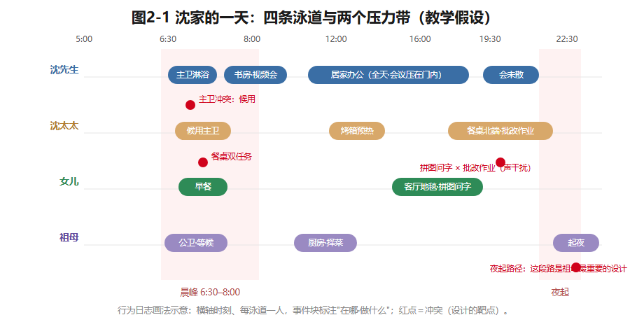
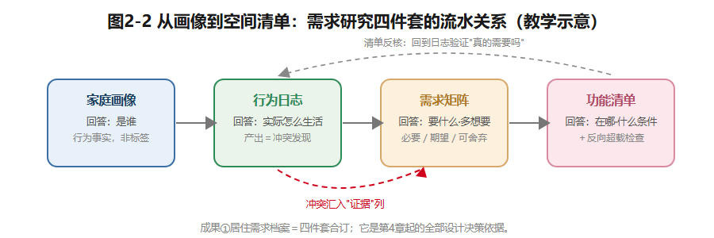

## 第2章 居住行为与空间需求

先看沈家很普通的一天（祖母长住期）。

6:40，主卫和公卫同时有人——沈先生赶晨会前洗澡，祖母已经在公卫门口等着。餐桌上，女儿的书包、沈太太的两摞作业本和早餐抢台面。8:00送完孩子，今天是沈先生的居家办公日，书房门关上，视频会议的声音压在门里；厨房里祖母慢慢择菜，烤箱定时预热——沈太太昨晚说，要烤一炉面包当明天的早餐。19:30，沈太太在餐桌北端批作业，烤箱计时器响了；女儿在客厅地毯上拼图，不时跑来问字；书房里的会还没散。22:30，客厅只剩一盏灯，祖母起身，走向紧邻房门的公共卫生间——这段摸着黑也要走的短短的路，是这套房子对一位68岁老人最重要的设计。

一天之内，同一套89㎡，被不同的人用不同的节奏反复改写。上一章说要"把名词翻译成功词"，本章就教你翻译，并做出全书第一个正式成果：**成果① 居住需求档案**——后面所有设计决策的依据。

### 2.1 先分类：频率、归属、节律

一个家一天发生几百件事，逐条记既不可能也没必要。分类是为了压缩信息、暴露矛盾。三条轴：频率、归属、时间。

**按频率：必需、经常、偶发。**判断标准是"多久发生一次×没有它会怎样"。**必需**：每天发生、缺了生活就卡住——睡觉、吃饭、洗漱、基本做饭。**经常**：每周多次、方式可变——居家办公、学习、烘焙。**偶发**：低频，却常给空间留下深刻印象——待客、年夜饭、生病照护。三类的空间含义不同：必需决定**底线**（晨峰两个卫生间能不能分流，决定每天早晨的生活质量）；经常决定**品质**（工作位和烘焙台有没有被正式支持）；偶发决定**弹性**（家里还保不保有"待客的能力"）。

这里有一处典型的取舍。偶发的待客，一种做法是按"每周都来客"配置固定沙发阵加专职客卧——日常的维护和空间占用随之上来；另一种是按真实频率设灵活座席和折叠安排——高峰期挤一点。两个方向都有道理，**裁决依据不是设计师的偏好，而是这个家真实的社交频率**。而这，正是行为研究要回答的问题。

**按归属：个人、家庭共同、社交接待。**个人行为（睡眠、办公、备课）要私密安静；家庭共同行为（晚餐、共同休闲）要聚合共享；社交接待把外人请进来，要在待客区和私密领域之间有边界。三种归属常常争夺同一个空间——你已经见过沈家的餐桌：白天是女儿的作业桌，傍晚是全家晚餐桌，晚上是沈太太的工作台，周末还可能是客人围坐的茶桌。**一物多用是住宅常态，不是例外**；89㎡不允许给每种用法配一间专属房，设计的目标是让切换顺畅、互不践踏。

**按时间：节律。**生活不是匀速流。**昼夜节律**：晨峰和深夜是两个压力峰值——深夜的冲突集中在声与光，晨峰的冲突集中在卫与桌。**工作日与周末**：两套行为集合；沈先生每周约两天居家办公，工作日内部又分两种工况。**季节节律**：祖母每年长住三到四个月，同一户型一年里有"四口之家"和"三口之家"两种状态。设计针对的不是"平均的一天"——平均的一天不存在——而是**峰谷结构：峰值决定容量，谷值决定弹性**。

*图2-1 沈家的一天：四条泳道与晨峰、夜起两个压力带；红点＝冲突（设计的靶点）。教学假设。*

### 2.2 家是会变的：生命周期与两代同住

家庭沿"生命周期"移动，需求跟着变（"家庭生命周期"是家庭社会学的常用概念，教学转述；学术定义以原典为准）。**成家期**，两人世界、对外交往多，起居就餐的聚合品质优先；**育儿期**，防护、婴儿床、玩具收纳成了新变量，动线要按"抱着孩子走"重新计量；**学龄期**，学习角和独立房间需求上升，孩子的东西从大件（婴儿车）变成小而多（图书、文具、手工材料）；**青少年期**，私密和隔声诉求强烈，代际摩擦需要空间来调解——一扇可以关上的门；**空巢期**，房间过剩而适老要求上升，住宅面临"减配与改造"的课题。

对沈家，五到十年内就有两件大事：女儿从六岁长到青春期，祖母可能转为常住。所以本课程的基本判断是两句话：**为当下的阶段设计到位**——不敷衍眼前的真实需求；**为下一个阶段留出可变性**——用可变项（可调隔墙、可重组家具）去预留，而不是一间常年空着的房间。

沈家还有个特殊结构：祖母的长住不是一个"阶段"，而是**把另一个家庭单元并置进同一套住宅**——她的作息、饮食、起居习惯、私密边界，整套都要进来。冲突点具体而日常：老人早睡，撞上晚间备课和会议；晨峰的卫生间再添一人；口味和做饭节奏也不同。U90"公卫紧邻书房（老人房）以西"这个设定，正是对这种并置的空间回应之一（完整课题第6章展开，改善型U120第12章拓展）。

由此引出本章第二处取舍：**专职老人房，还是书房/老人房双模式折叠？**专职：祖母不在的约八个月里闲置、落灰、占一间房。折叠：每次转换都要整理，而且办公与适老两种功能都得在2.9×3.0米、8.7㎡里自洽。没有标准答案——长住月份趋向增加的家，专职化的理由逐月变强；稳定在三四个月的家，双模式更高效。**需求的时间性本身，就是裁决材料。**

### 2.3 三件工具：画像、日志、矩阵

**工具一：家庭画像——回答"是谁"。**一行一位成员，几列关键信息，两条纪律：每格注明来源（访谈所得/观察所得/教学假设）；写**行为事实**，不写人物标签——"6岁，物品小、多、换得快"对设计有用，"可爱的小公主"没用。

| 成员 | 年龄与身体条件 | 职业与作息 | 核心活动 | 物品与设备 | 关键设计输入 |
|---|---|---|---|---|---|
| 沈先生 | 35 | 软件工程师；每周约2天居家办公 | 长时间视讯、双屏工作 | 双屏与主机设备 | 隔声、网络稳定的固定工作位 |
| 沈太太 | 33 | 中学教师；晚间备课与批改 | 备课、批改、烘焙 | 作业本；烤箱与小家电密集 | 餐桌一端工作位；烘焙操作与收纳 |
| 女儿 | 6 | 学龄前后 | 游戏、阅读、未来的学习 | 物品小、多、更替快 | 游戏阅读角与可成长的学习空间 |
| 祖母 | 68；膝关节不便，无需轮椅，怕摔、怕黑 | 每年长住3–4个月，或转常住 | 慢节奏起居、择菜等轻家务 | 少而稳定 | 就近如厕、防滑、夜间照明、扶手预留 |

（全部为教学假设，依户型库。）

**工具二：行为日志——回答"实际怎么生活"。**横轴是时刻（建议5:00–24:00，半小时一格），纵轴是空间（按房间分行）或人（泳道），逐人记录。三条要求：记满三天——两个工作日＋一个周末日，至少一天在祖母长住期；记五要素——**时刻、人、空间、行为、冲突**；日志的产出不是行为清单，而是**冲突发现**——同一时刻、同一空间或同一设施上两个行为撞在一起，那就是设计的靶点。沈家晨峰片段（教学示例）：

| 时刻 | 卫生间 | 厨房与餐区 | 玄关与客厅 | 书房 | 冲突 |
|---|---|---|---|---|---|
| 6:30–6:50 | 沈先生淋浴（主卫）；祖母用公卫 | — | — | — | — |
| 6:50–7:10 | 沈太太候用主卫 | 女儿早餐；作业本占餐桌一角 | 女儿收书包 | 沈先生预读邮件 | 候用主卫（容量型）；餐桌双任务（容量型） |
| 7:10–7:30 | — | 三人早餐，桌面不足 | 全家同时出入玄关找鞋 | — | 玄关峰值（路径型） |

**工具三：需求矩阵——回答"要什么、多想要"。**行是需求项，列是归属与证据，值分三级：**必要**（缺了生活受阻或安全受损）、**期望**（显著提升品质，可排队可折衷）、**可舍弃**（可替代、可延迟、可共享解决）。沈家节选：

| 需求项 | 归属 | 分级 | 证据 |
|---|---|---|---|
| 双屏视讯工作位（隔声、网络） | 沈先生 | 必要 | 每周约2天全天办公 |
| 餐桌端部晚间工作位 | 沈太太 | 必要 | 晚间备课批改的习惯 |
| 烘焙操作与小家电收纳 | 沈太太 | 期望（设备收纳按必要） | 烤箱与小家电密集 |
| 就近如厕与夜间安全路径 | 祖母 | 必要 | 68岁、膝关节不便、怕摔怕黑 |
| 游戏阅读角与成长型学习角 | 女儿 | 必要 | 6岁学龄前后 |
| 专职客卧 | 全家 | 可舍弃 | 待客为偶发（2.1频率分析），已有双模式房 |

注意一个细节：**同一需求内部也可以分级**——烘焙操作台是期望（可以向餐区折衷延伸），但烤箱和常用小家电的安置是必要（设备已经存在且密集，没地方放就是生活受阻）。

**访谈与观察，互补也打架。**访谈给你意愿和解释（"我们很少在家做饭""我想要一个大书房"），观察给你事实（一周三次煎炒浓烟；每周约两天全天用书房）。矛盾时，矛盾本身就是设计输入。功夫在于把愿望翻译到行为层：为谁用、每周几次、每次几小时、做什么、要什么支持——翻译之后，"大书房"往往变成"一间隔声好、有双屏位和稳定网络的小房间，加一张能摊开材料的工作台"（教学假设）。三条处理原则：非安全类矛盾，带回追问和二次观察；涉及安全健康的（防滑、夜灯），按更保守的一方处理；不把愿望当设计事实，也不把观察到的惯性当不可改变的未来——**设计既服务行为，也适度引导行为**。

### 2.4 三类人，放大镜下

**儿童：成长性与安全。**6岁的儿童房，到12岁要变"睡眠＋学习"，到青少年还要加上"一扇可以关上的门"。两条要点：**基础装修中性化，成长交给家具**——固定投入服务长期结构，阶段需求用可换家具承接；**收纳低而浅**——孩子看得见、够得着、自己收（教学常用值：常用收纳高度不超过约900mm），自己收拾本身就是儿童房的教育内容。安全上，防坠落、防夹手、插座防护、家具稳定与角部、材料环保，都要与住户逐项确认，具体按现行标准与产品规范核验。

**老人：以祖母为例。**设定再念一遍：68岁，膝盖不便，不用轮椅，但怕摔、怕夜里摸黑，每年长住三到四个月、未来可能常住。四个要点：**就近如厕**——卧室到卫生间短、直、沿途有可扶的界面（U90公卫紧邻老人房，是既定条件）；**防滑**——面层防滑、消除高差、湿区干湿分离（等级与构造须核验）；**夜间照明**——起夜路径上低位、低色温、感应式，够看清路又不晃眼（照度值第8章；"夜间如厕随年龄上升并影响睡眠"已有同行评议研究证实——已核实线索：JMIR Nursing 2025综述，频次数据不引入课堂）；**扶手预留**——如厕位与淋浴位附近墙面预埋加固，安装高度教学常用值约850–900mm，按使用者身体条件与现行标准核验（已核实线索：民政系统居家适老化改造指南有官方文件，数值以原文为准）。祖母目前按"怕摔、怕黑"的轻度适老设计，同时为更高级别需求预留升级——情境B就是兑现时刻。**声明**：无障碍与适老化的具体尺寸等级构造，须按GB 55019-2021《建筑与市政工程无障碍通用规范》（已核实线索：住建部发布、与中国残联联合推进）等现行标准核验，由有资质的专业人员设计施工；本课程只建立"意识—识别—预留"，不作合规结论。

**居家办公者：专注与强度。**沈先生的办公不是"偶尔在家写写字"，而是每周约两天、全天、长时间视讯。三个要点：**专注性**——工作位远离客厅声源，靠房门、位置和软装控制干扰（隔声构造见第11章）；**使用强度**——日均8小时在桌和偶尔写封信，是两个人体工程等级（第3章展开），双屏台面宽教学常用值约1600–1800mm、深约600–800mm，座椅后留拉椅与通行净空；**配套**——稳定网络点位、屏幕避开主窗逆光、长时间工作的环境光比（第8章）。一句话：**办公桌不是书桌——使用时长决定投入等级。**

### 2.5 从需求到空间清单

需求研究的终点不是愿望清单，而是能直接进入设计谈判的**功能清单**。三条翻译规则：

1. **每项需求翻译成"位置＋支持条件"，不只写房间名。**"双屏居家办公"不是"书房"两个字，而是"固定工作位：台面宽约1600–1800mm、隔声门、专用网络与足够电位、屏幕避开主窗逆光"。
2. **面积给意向区间，用现有户型校核。**例：主卧放1.8m双人床、两侧各600mm通行、一侧600mm深衣柜，净宽意向约3.6m——对照U90主卧净宽3.6m：**刚好成立且无余量**，说明衣帽区必须动用3.85m方向的进深（均为教学常用值）。校核的意义，是提前发现"意向与固定项的冲突"。
3. **优先级是裁决机制。**必要项不妥协，期望项排队折衷，可舍弃项写明理由——面积和预算打架时，清单就是谈判桌，裁决依据回到证据列。

示范：把沈家需求翻译成空间任务（依户型库，新数值为教学常用值/教学假设）：

| 需求（证据） | 空间任务 | 落点 | 优先级 |
|---|---|---|---|
| 双屏视讯办公，每周约2天 | 固定工作位：隔声门、网络点位、台面宽≥1600mm | 书房 | 必要 |
| 晚间备课批改（餐桌一端） | 餐桌北端常设工作位：工作灯、电位、文件收纳 | 客餐厅餐区 | 必要 |
| 烘焙＋小家电密集 | 操作台延伸与高柜收纳：烤箱点位、小家电库 | 厨房，必要时向餐区/生活阳台折衷 | 期望（设备收纳必要） |
| 女儿游戏阅读与未来学习 | 可成长布局：游戏阅读角渐变为学习角；低而浅收纳 | 儿童房 | 必要 |
| 祖母长住四要点 | 东北角房间双模式：夜灯回路、防滑面层、扶手预埋 | 书房/老人房＋紧邻公卫 | 必要 |
| 待客（偶发） | 灵活座席与折叠安排，不设专职客卧 | 客餐厅 | 可舍弃（专职客卧） |
| 晨峰出入缓冲 | 坐凳换鞋＋鞋柜按四季与客用配置 | 玄关 | 必要 |
| 晾晒与家务（双阳台） | 生活阳台承担家务晾晒与设备，南阳台保持观景 | 北侧生活阳台 | 必要 |

清单做完，还要做一次**反向超载检查**：把每行落点放回U90平面，看同一间房接收的任务是否超载——本表里"书房"已经同时接了"每周两天全天办公"和"老人房双模式"双重任务，8.7㎡的容量正是第4章要解决的核心矛盾之一。**功能清单是谈判的开始，不是结束。**

*图2-2 需求研究四件套的流水关系：冲突汇入证据列，清单回到日志反核。教学示意。*

### 想一想

1.（选择）"家里一年办两次家宴"对应的需求处理，最合理的是——A. 按每周办宴配置固定大餐桌；B. 列为偶发行为，用折叠/借用弹性解决；C. 因为低频直接无视。
2.（选择）访谈说"很少做饭"、观察记录"一周三次煎炒"，处理原则是——A. 听客户的；B. 信眼睛的；C. 带回追问与二次观察，涉及安全的按保守方处理。
3.（简答）写一条你自己生活中"访谈问不出来、只有日志能记下来"的行为，并说明为什么问不出来。

### 实践任务卡：沈家的一天·行为模拟

**任务**：四人一组，在1:50的U90简化平面图上角色扮演沈家一天，亲身撞出冲突（**成果① 居住需求档案**的实践部分）。
**要求**：①分饰四口（角色卡按户型库：作息、当日任务、身体条件）；②用棋子按五个回合走位——晨峰6:30–8:00、上午10:00、午后16:00、晚间叠加19:30–21:30、夜间23:00起夜；③每回合各角色声明"我在哪、做什么、需要什么"，声明与平面不符的当场暴露（说"在餐桌备课"，可餐桌此刻摆着晚餐）；④记录全部冲突（时刻/空间/人/原因），复盘时归类为**容量型／干扰型／路径型／时段型**，反推需求项补入矩阵；⑤"最意外发现"一则（150字内）。
**交互形式（线上实现，教材不绑定平台）**：作息时间轴拼合动画（发现晨峰冲突）、角色走位模拟、冲突自动标注与归类统计。

### 本章小结

把住宅从名词翻译成功词：先按频率、归属、节律分类行为，再用画像、日志、矩阵三件工具收拢成需求档案，最后翻译成带优先级的空间清单，并用反向超载检查防止单间超载。家是会变的——为当下设计到位，为下一段留出可变性；两代同住不是阶段叠加，而是两个家庭的并置。

带走两句话：**峰值决定容量，谷值决定弹性。愿望要翻译成行为，行为要落到证据。**

*（教学提示：本章学时、教师观察点与参考答案要点见配套《教师手册》。）*

---

*本章尾注·资料来源与核验记录*

| 素材 | 核验状态 | 来源 |
|---|---|---|
| "家庭生命周期/家庭生活周期"概念 | 教学转述（概念词条已核实存在） | 知网百科"家庭生活周期"词条；学术定义以社会学原典为准 |
| GB 55019-2021《建筑与市政工程无障碍通用规范》：名称、发布主体、强制性地位 | 已核实线索 | 住房和城乡建设部发布公告；住建部、中国残联贯彻实施报道（2026-10检索） |
| 居家适老化改造做法（扶手、防滑、感应照明等） | 已核实线索（官方指南存在，数值以原文为准） | 民政系统居家适老化改造指南文件（省民政厅公开转发件） |
| 扶手安装高度约850–900mm | 教学常用值 | 课堂推理值；正式引用前须对照适老化指南原文核验 |
| 老年人夜间如厕次数上升且影响睡眠 | 已核实线索（现象层面） | JMIR Nursing 2025 综述（同行评议）；具体频次数据未引入 |
| 沈家画像、行为日志、需求矩阵 | 教学假设（原创设计） | 本书户型库；不含外部事实主张 |

> 网络来源仅用于事实核验与转述标注，不构成内容转载授权；正式出版前须复核标准现行版本与指南原文。
