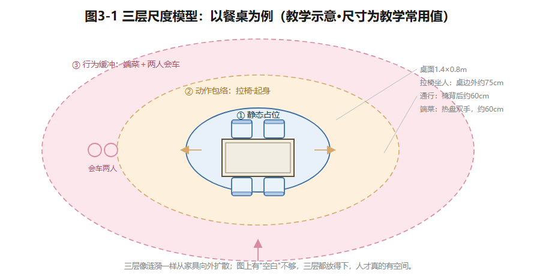
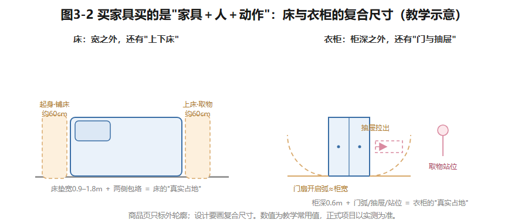
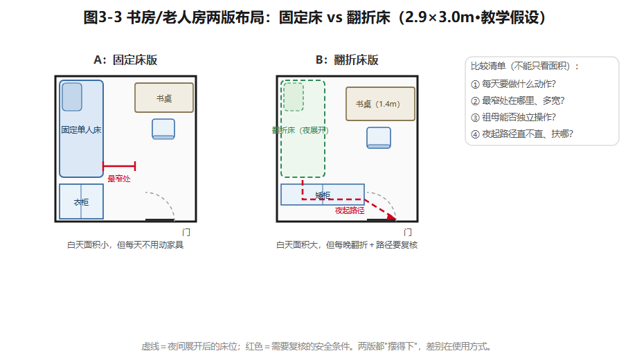

## 第3章 人体工程学与住宅尺度

沈家换了张六人餐桌。送货那天，桌子推进客餐厅，看起来刚刚好。晚饭时麻烦来了：椅子一拉开，去厨房的人只能侧着身子挤过去。

图纸上有"空白"，不等于人有空间。这张桌子教会我们一件事：**住宅尺度要同时画三样东西——物体、人的动作、人和人相遇时的余地。**本章就教你把这三样东西都画出来。

### 3.1 从"站着多大"到"活着多大"

人体工程学的第一课，恰恰是**别去找一个"标准人"**。身体尺寸随年龄变化；同一个人，站着、弯腰、拉椅子、抱着孩子转身，需要的空间都不一样。沈家里有成年人、六岁的女儿、膝盖不便的祖母——一套房子要同时装下三种身体。

所以分析一个空间，分三层看：

1. **静态占位**——人和家具"本身"占的地方；
2. **动作包络**——开门、拉椅、转身、取物时**划过**的地方；
3. **行为缓冲**——两人会车、临时放东西、扶老人走一步的**余地**。

还是那张餐桌：桌面长宽决定菜放不放得下（静态）；椅子本体决定不用时占多少（静态）；拉椅、起身、旁人通过，共同决定桌边要留多少（包络＋缓冲）。同一张桌子，靠墙摆、居中摆、贴厨房摆，通行条件完全不同。所以——**永远不要先买家具、再从剩下的平面里"挤"通道。**

*图3-1 三层尺度模型：静态占位→动作包络→行为缓冲，像涟漪一样从家具向外扩散。教学示意。*

人群差异怎么处理？人体工程学用**百分位数**：P5到P95覆盖了绝大多数人的身体范围（这是人因工程学的通行方法，教学转述；我国人体尺寸的基础标准是GB/T 10000-1988《中国成年人人体尺寸》，已核实标准目录可查，现行有效性须核验）。但平均值覆盖不了一个家的全部成员：女儿够不到的高处收纳，和祖母需要扶一把的路径，可能出现在同一套房子里。所以尺寸图上要写清**测量对象、动作、使用条件**，而不是只写一个孤零零的数字。

### 3.2 通行不是一条线

"通行"不只是从入户门走到各房间，还包括床边起身、餐椅后退、橱柜开门这些局部动作。画图的方法：先标固定障碍（墙体、结构、门洞），再叠上家具实体、门扇开启弧线、动作包络，最后检查起点到终点**是否连续可达**。全程可用与否，往往取决于**最窄的那一段**。

课堂上用三个情境逐级测试：**单人通过 → 两人会车 → 辅助器具通过**。同一条走道，空手走显宽裕；衣柜门一开、婴儿车一放，立刻变窄。碰到最窄段，先记录"哪里窄、什么动作造成的"，再决定是调门、换柜、挪家具，还是重新组织房间。别忘了那些"偶发"物件：儿童房门外地垫、餐桌边临时加的折叠椅，都要算进去。

（建筑通行净距的国家查核入口是GB 55031-2022《民用建筑通用规范》，已核实由住建部发布；条款数值须按现行文本核验，本书不转述。涉及轮椅、助行器或适老改造的，必须按使用者身体条件、器具规格、现场测量及现行规范复核——课堂图示只能帮你**发现问题**，不能替你宣布"无障碍达标"。）

### 3.3 买家具，买的是"家具＋人＋动作"

家具商品标注的尺寸是**外轮廓**；设计需要的是**复合尺寸**——家具本体＋使用者＋动作。床宽决定睡几个人，可床边还要能上床、铺床、床头取物；餐桌长度看常吃饭的人数，椅背后要不要走人，取决于桌子摆在哪；衣柜的柜深，要和门扇开启、抽屉拉出、人站着换衣服一起算。

| 对象 | 商家常标的 | 设计时还要查 |
|---|---|---|
| 床与床头柜 | 床垫、床架外轮廓 | 起身、铺床、床头灯与插座够不够得着 |
| 餐桌椅 | 桌面长宽、椅子宽深 | 拉椅、端菜、椅背后通行 |
| 书桌 | 台面长宽、桌面高度 | 视屏距离、椅子后退、窗户眩光 |
| 衣柜 | 柜体宽深高 | 开门/抽屉范围、取物站位 |
| 厨房柜体 | 模块尺寸 | 烹饪动作、门板开启、多人错身 |

这张表**故意不给"合格值"**——不同厂家的柜深、把手、门铰都会改变净空。正确的做法：实测你在用的家具，画至少一幅**带比例的动作包络图**，再用产品资料或现场数据修正。

*图3-2 买家具买的是"家具＋人＋动作"：床垫宽与柜深之外，还有包络、门弧与站位。教学常用值。*

### 3.4 方便，要说清方便谁

"方便"这个词，必须追问：**方便谁？**玩具收纳放低处，孩子够得着、自己收——可大人扫地要弯腰。柜子全部做到顶，容量最大化——祖母一个人在家时，取高处的风险谁来担？儿童、老人、腿脚临时受伤的家人，都应该在设计早期被"看见"。但看见不等于给每个人配同一套设备——包容性是**同一空间里多种身体的共存**，不是设备的堆叠。

U90的书房/老人房就是考题：2.9×3.0米的净空间（教学假设），平日要装下工作位，祖母长住时要装下床和储物。用翻折床，白天能腾出工作面积——但要检查：夜晚展开后，床到门的路通不通？翻折机构老人操作得动吗？起夜时手能扶哪里？用固定床，白天面积缩水——但换来每天不用搬家具。记住一句冷峻的话：**几何上"不重叠"，不等于老人夜里起身安全。**

### 3.5 从教学值到项目值

课堂尺寸用来**发现关系、生成方案**；正式项目的尺寸取决于产品实测、使用者测量、施工误差和现行规范。建议把所有数据分四栏管理：**已实测、产品资料、教学假设、待专业复核**。比如"祖母夜间通行宽度"，只要还没做器具测量，就不能在图上写成"符合规范"。图纸的严谨，首先体现在**来源和条件写清楚**，而不是小数点后面有几位。

**示范例题**：给U90书房/老人房布置单人床＋书桌＋柜体。第一步，画2.9×3.0米净边界，列两版家具外轮廓（标注教学假设）；第二步，为开门、起身、书椅后退分别画动作包络；第三步，比较固定床与翻折床两版——"每天要做什么""最窄处在哪里""祖母能否独立操作"。结论不能只看谁空出的面积大。

*图3-3 固定床版 vs 翻折床版：两版都"摆得下"，差别在每天要做什么。教学假设。*

### 想一想

1.（选择）"图上有空白就够走人"错在——A. 空白太小；B. 空白没叠加动作包络和会车缓冲；C. 比例不对。
2.（选择）衣柜"柜深600mm"不能直接判断放得下，还缺——A. 颜色；B. 门扇开启/抽屉拉出/取物站位；C. 材质。
3.（简答）你家里最窄的一段通行在哪里？是什么动作让它变窄的？用三层模型（静态/包络/缓冲）说一遍。

### 实践任务卡：家具尺度与通行实验

**任务**：实测一组餐桌椅＋一组床柜，亲身体三种状态（收拢/正在使用/两人会车）。
**要求**：①按比例画俯视图（手绘、模型、制图工具均可）；②分别测三种状态下的最窄段，记录数值与来源；③把数据填进四栏表（已实测/产品资料/教学假设/待专业复核）；④形成"家具实体—动作包络—通行路径"尺度检查单——它是第4–12章各轮方案复核的随身工具。
**交互形式（线上实现，教材不绑定平台）**：家具拖入房间、动作包络动画展开、最窄段自动测量与超标提示。

### 本章小结

尺度分三层：静态占位、动作包络、行为缓冲；通行看最窄段，不看平均宽度；买家具买的是"家具＋人＋动作"的复合尺寸；"方便"必须说清方便谁；数据永远分四栏，来源清楚比小数点重要。

带走两句话：**图上有空白，不等于人有空间。几何不重叠，不等于安全。**

*（教学提示：本章学时、教师观察点与参考答案要点见配套《教师手册》。）*

---

*本章尾注·资料来源与核验记录*

| 素材 | 核验状态 | 来源 |
|---|---|---|
| 百分位数设计方法（P5/P50/P95） | 教学转述（通行方法） | 人因工程学通行教材表述；正式引用前指定版本 |
| GB/T 10000-1988《中国成年人人体尺寸》标准名称与年代 | 已核实线索（标准目录可查） | 中国标准在线服务网标准目录（2026-10检索）；现行有效性与替代版本须核验 |
| GB 55031-2022《民用建筑通用规范》名称与发布主体 | 已核实线索 | 住房和城乡建设部发布公告（mohurd.gov.cn，2026-10检索） |
| 本章通行宽度、家具净距等具体数值 | 教学常用值（原创课堂推理值） | 本书自定；正式项目以实测、产品资料与现行规范为准 |
| 沈家成员身体条件与尺度情境 | 教学假设 | 本书户型库 |

> 网络来源仅用于核验标注；标准只作"查核入口"指引，不转述条款数值。
