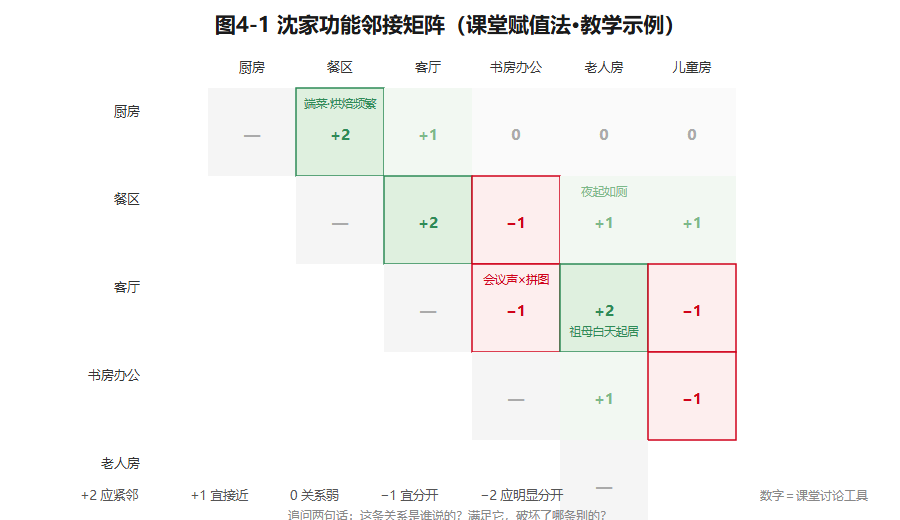
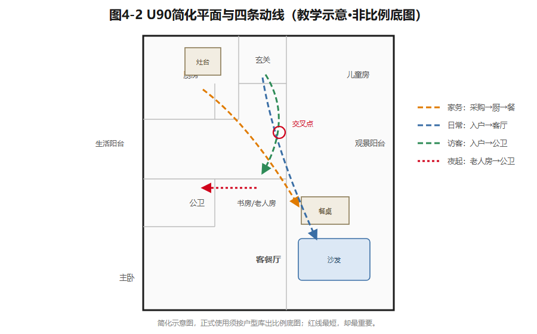
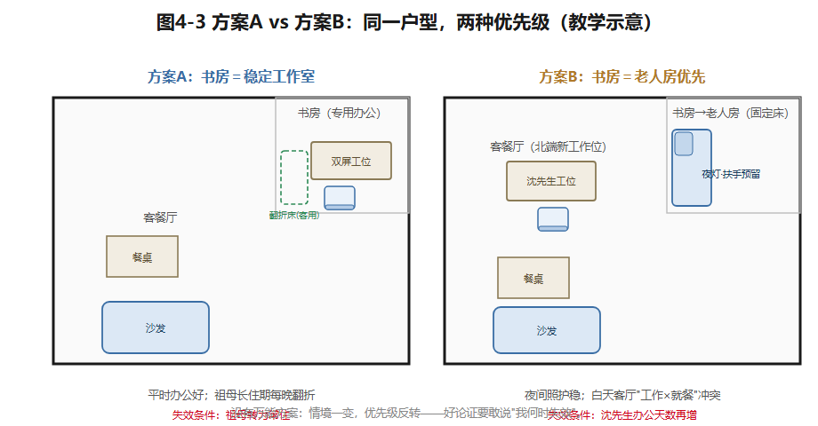

## 第4章 住宅功能分区与动线

沈家入住五年了。女儿12岁，需要自己的学习区；祖母从每年小住，变成了常住；沈先生居家办公的天数也多了。原来够用的书房挤了，餐桌晚上被两个大人同时占用——太太批作业，先生开会。

房间还是三个，承重墙没变，厨房卫生间也没挪。这时候设计的任务，**不是给每个房间重新贴标签，而是调整活动之间的关系**，并诚实地判断：这个户型，能承受需求变化到什么程度？

### 4.1 先摆关系，再画墙

第2章的需求矩阵，先翻译成**活动和房间的关系**，别急着画墙。住宅里的事大致有：睡眠、起居、就餐、备餐、盥洗、家务、储物、工作学习。注意——**同一个功能可以跨房间发生**：餐桌兼备课，卧室兼阅读，书房兼客卧。如果只会"一个功能配一个房间"，89㎡永远不够用，而且是把"面积紧张"误诊成了"房间不足"。

分区用四组关系来分析：

- **动与静**——聊天看电视（动）和睡觉学习（静）会不会互相打扰；
- **内与外**——访客的路线会不会看到这个家最私密的部分；
- **洁与污**——入户的外衣书包、厨房垃圾、清洁工具怎么归置；
- **干与湿**——洗澡、晾晒和干燥储物怎么分开。

（这套"动静/公私/洁污/干湿"是住宅设计原理的通行框架，教学转述、本书按教学需要重组。）四组关系不是四条禁令。老人房贴着公卫，夜里方便，可可能挨着早晨最忙的活动带；开放餐厨让全家共享做饭时光，可油烟和噪声也一起来了。设计者的工作不是消灭矛盾，而是**说清优先级和补救措施**。（住宅各空间的最低使用要求——卧室、起居室面积下限等——以GB 50096-2011《住宅设计规范》为查核入口，已核实现行可查；条款数值以现行文本为准，本书不转述。）

### 4.2 邻接矩阵：把设计假设摊在桌面上

**功能邻接图**：一个节点一个功能，连线表示"要靠近"或"要分开"。本课程用五档赋值：**+2应紧邻、+1宜接近、0关系弱、−1宜分开、−2应明显分开**。这些数字是课堂讨论工具，不是国家标准，也没有脱离家庭的"最优解"。

举例（沈家）：厨房↔餐区＝+2（端菜、收拾、烘焙备料太频繁）；祖母卧室↔公卫＝+2（夜间如厕）；居家办公↔儿童游戏区＝−1（干扰）——但能不能靠一扇门和时段管理共存？要看这个家怎么用。

矩阵写完，追问两句话：**第一，这条关系是谁说的？**访谈所得、观察所得，还是你猜的？**第二，满足这条紧邻，破坏了哪条别的？**U90公卫紧邻书房/老人房是固定条件，对祖母是+2；可一旦书房变成全天办公区，卫生间的开门声就成了专注的敌人。**矩阵只负责把冲突摆上桌面，不替你裁决。**

*图4-1 功能邻接矩阵：+2绿/−1红，证据来源随格标注；数字是讨论工具，不是标准。教学示例。*

### 4.3 画出这个家的动线

至少画三条**有起点有终点的任务路径**：

- **住户日常动线**——入户、换鞋、进卧室或客厅；
- **访客动线**——从进门到公共活动区和公卫；
- **家务动线**——采购→厨房→餐区；脏衣→洗衣机→生活阳台→归置。

再加一条最容易被忽略的：**夜间短路径**——祖母从床到公卫的那几步。用不同颜色把路径叠在同一张平面图上，标出交叉点、折返、门扇打架的地方、最窄段。

一个提醒：**短不等于好**。访客直穿卧室门口去卫生间，省了三米，可私密没了；洗衣路径绕远一点，换来休息区的安静，可能是划算的。近年流行的"回游动线"（房间之间形成环路、减少折返）确实好用，但环路也要吃掉储物墙和面积——**判断标准永远是这个家的行为频率，不是流行词。**

*图4-2 U90简化平面＋家务/日常/访客/夜起四条路径；交叉点画圈。简化示意，正式使用须出比例底图。*

### 4.4 在固定约束里做设计

画U90布局之前，先把场地条件**分三色**标出来：

- **红色·不可改**：外墙外窗、两道剪力墙、厨卫管线与降板；
- **黄色·可讨论**：非承重隔墙（如儿童房与书房之间）、室内门位；
- **绿色·随便动**：全部活动家具。

改造的顺序也有讲究：**保留固定项 → 重分配功能 → 调家具和门位 → 最后才讨论隔墙 → 涉及结构必须专业复核**。很多时候，**改门的方向比拆墙有效得多**；书房改老人房，先比较固定床与可变床，而不是先想拆哪堵墙。还有一句丑话说在前：你平面图上的"可变"，是教学场景给你的授权；真实项目要结构和物业说了算。

### 4.5 比较方案，而不是给方案打分

两版方案，至少从五个角度比：功能分区回应了优先需求吗？动线交叉干扰多少？主要房间采光怎样？日常储物在哪？五年后还能调整吗？家具交叠、越界这类**可观察现象**可以交给计算工具；私密性、氛围、施工可行性，要靠住户试走和评议——**别把它们合成一个来路不明的"AI专家分"**。

看沈家的真实考题。**方案A**：书房做稳定工作室，祖母来了用可变床——平时办公条件好，祖母长住期每次都要翻折整理。**方案B**：以祖母常住优先，书房放固定床，沈先生的工作位挪到客餐厅北侧——夜间照护稳定，但客餐厅白天黑夜都面临"工作vs就餐"的时段冲突。哪个好？**取决于祖母是"季节性"还是"常住"**——情境一变，优先级就反转。优秀的方案论证，要敢说出一句话：**"在什么情况下，我的方案会失效。"**

*图4-3 同一户型两种优先级：A办公优先、B照护优先，各自标出失效条件。教学示意。*

### 想一想

1.（选择）"一个功能配一个房间"的主要错误是——A. 房间太多；B. 把面积紧张误诊为房间不足；C. 动线变长。
2.（选择）邻接矩阵里"书房↔公卫＝+2"这个判断，最需要追问的是——A. 数字写法；B. 关系是谁提出的（访谈/观察/猜测）；C. 颜色。
3.（简答）画你家（或宿舍）的"夜间短路径"：谁、从哪到哪、路上有什么障碍？

### 实践任务卡：U90两版布局（成果②）

**任务**：在U90净尺寸和固定项约束下，完成A/B两版比例平面布局——全书核心成果②"户型组织方案"。
**要求**：①先交三色条件图（固定项/可讨论/可动）；②每版标出功能归属、主要家具、三条动线（日常/访客/家务）和夜起路径；③各指出一处关键冲突＋一个"平面几何看不出"的风险（如时段冲突、照护负担）；④附200–300字取舍说明，写明"我的方案何时失效"；⑤选定情境A（现状）或B（五年后）作为设计对象，全文一致。
**交互形式（线上实现，教材不绑定平台）**：拖拽房间块生成布局、动线自动叠加与交叉计数、A/B并排热区对比。

### 本章小结

先摆关系再画墙：四组分区关系＋邻接矩阵把设计假设摊上桌面；动线至少三条＋夜起路径，短不等于好；固定项三色标注，改门常比拆墙有效；方案比较讲条件、讲失效，不讲万能分。

带走两句话：**矩阵只摆冲突，不替你裁决。敢说何时失效的方案，才是好方案。**

*（教学提示：本章学时、教师观察点与参考答案要点见配套《教师手册》。）*

---

*本章尾注·资料来源与核验记录*

| 素材 | 核验状态 | 来源 |
|---|---|---|
| GB 50096-2011《住宅设计规范》：名称、现行状态 | 已核实线索 | 国家标准馆·国家数字标准馆；国标电子书库（中国建筑工业出版社，2026-10检索）；条款数值以现行文本为准 |
| 动静／公私／洁污／干湿功能分区框架 | 教学转述（通行表述，本书重组） | 住宅设计原理通行框架；同类概念另见专利文献CN103821383A背景技术部分 |
| 邻接矩阵赋值法（+2至−2） | 教学原创方法 | 本书设计；数字为课堂讨论工具 |
| U90固定项（剪力墙、厨卫降板、公卫邻书房） | 教学假设 | 本书户型库；无实测图纸，正式使用前须出比例底图 |
| 回游动线的利弊 | 教学转述（专业流行概念） | 媒体与专业文章常见提法；本书强调按家庭行为频率裁决 |

> 网络来源仅用于核验标注；规范只作查核入口，不转述条款数值。
