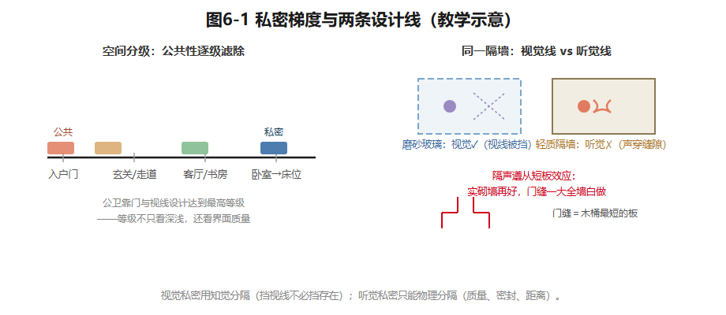
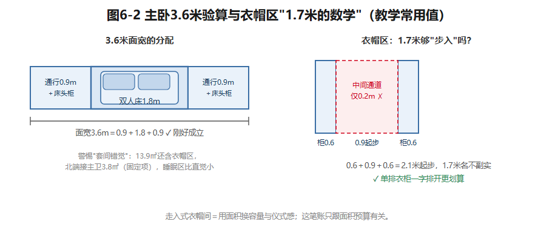
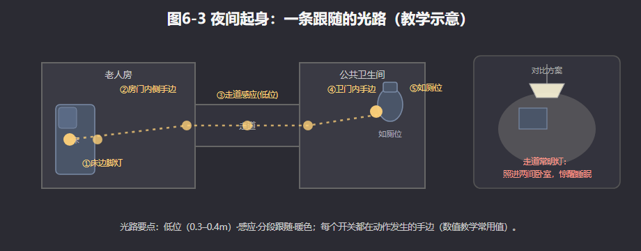

## 第6章 卧室、书房与私密空间

青枫里401的书房，在一年里扮演两个不能同时上演的角色。

祖母不在的日子，它是沈先生的书房：深夜视讯，声音可能穿过隔墙飘进隔壁儿童房。祖母长住的日子，它变成老人房：深夜里她要摸黑沿走道去紧邻的公卫，短短几步，看不清就是危险。两种夜里不会同时发生，却同时向设计者提出要求：**听觉的私密，和夜里的通行**。这正是双模式房间的难点——换的不只是家具用途，还有声、光和全家作息。

### 6.1 私密，是分层的

私密不是一扇门的事。环境心理学有经典的理论传统（已核实线索：Altman 1975年的著作确认存在并被广泛引用，核心视角是把私密性看作对社会交往的动态"调节"；更早的Westin 1967提出独处/亲密/匿名/保留四类，原典细节须核验。本书简化为三层）：

- **独处**——不被看见、不被打扰：睡眠、更衣、如厕；
- **亲密**——两人或小圈子共处时不被介入；
- **领域感**——"这是我的地盘"：房门、专属收纳、床的归属，都是物证。

独处要求**关闭**，亲密要求**过滤**，领域感要求**可标识**。住宅靠**空间分级**组织这条私密梯度：从入户门到床位，公共性经玄关、走道、转折、门，一层层滤掉。U90的分级表：

| 空间 | 私密等级 | 主导需求 | 脆弱点 |
|---|---|---|---|
| 主卧（3.6×3.85） | 高 | 独处＋亲密 | 门缝传声、衣帽区敞向床 |
| 儿童房（3.2×3.0） | 中 | 亲密＋成长中的领域感 | 与书房隔墙漏声 |
| 书房/老人房（2.9×3.0） | 中，随昼夜浮动 | 独处（工作/睡眠） | 同一道隔墙漏声 |
| 公共卫生间 | 最高 | 独处 | 门缝、视线对走道 |

注意最后两行：等级不只看"深浅"，还看**界面质量**——公卫靠一扇门和视线设计，做到了全屋最高等级。

私密还有**时间分级**：书房白天是工作区、夜里要绝对安静；客餐厅深夜反而是离卧室最远的安静角落。私密冲突多发生在**昼夜错位的时刻**——夜里的会议、清早的电视。对策两条：给错位功能找备用地点（深夜工作挪到餐区一角），或为高频错位强化界面（隔声墙、密封门）。

最重要的一条专业判断：**听觉私密与视觉私密是两条独立的设计线。**视觉私密处理"看得见看不见"，用**知觉分隔**就够——窗帘、磨砂玻璃、半高柜、动线转折：挡住视线不必挡住存在，一个转角就是一堵看不见的墙。听觉私密处理"听得到听不到"，只能靠**物理分隔**：质量、密封、距离。两条线常常一好一坏：磨砂玻璃视觉合格、听觉几乎为零；实砌墙隔声很好，门缝一大全墙白做——**隔声遵从短板效应**。书房与儿童房之间那道非承重隔墙，挡视线没问题，隔声取决于墙体构造、门窗缝隙和施工质量，不能只凭"轻质隔墙"四个字给分贝结论。画漏声路径图，把隔声量列入待核清单。（住宅室内允许噪声级与构件隔声的查核入口：《民用建筑隔声设计规范》GB 50118，已核实现行，数值以现行文本为准，本书不转述。）

*图6-1 左：从入户门到床位的私密分级；右：同一隔墙的视觉线（磨砂玻璃可解）与听觉线（只能物理分隔）。教学示意。*

### 6.2 卧室：从一张床开始

卧室设计从"这张床放得下吗"开始。教学常用值：单人床宽0.9–1.2米、长1.9–2.0米；双人床宽1.5/1.8米、长2.0–2.1米；床头板另加0.05–0.1米。双人床**两侧**各留0.5–0.6米（极限0.45米）才能侧身下床和铺床，床尾留0.6米以上——一侧靠墙的双人床，意味着总有一人要跨越同伴上下床。地台床边缘能坐、底下能储，小房间友好；但上下床要完整的"坐起—转身—落足"动作，边缘夜里是绊倒点，膝盖不便者不宜（6.4的伏笔）。

拿U90主卧验算：3.6米面宽放1.8米床，两侧各余0.9米——床头柜放得下，通行也够。但要警惕"套间错觉"：13.9㎡里还含着衣帽区，北端还接着主卫3.8㎡（固定项），睡眠区的有效面积比直觉小。主卧东界是剪力墙——密实墙体是隔声红利；衣帽区怎么隔，是可变项。

**床头是毫米级的战场。**床头板高0.9–1.1米好倚靠；床头柜台面高0.5–0.55米；插座两处五孔加USB、距地约0.7米、居床侧中线——别被柜子挡死；开关必须双控（门口＋床头）。台灯可移动但占台面，壁灯省台面但位置焊死。这里是本章第一处取舍：**插座和壁灯埋进墙里，十年难改**——宁可用家具平面图推定电位，绝不可先布线后摆家具。

**衣柜三问。**一问深度：柜体0.6米、挂衣净深不小于0.53–0.55米，浅于0.5米挂衣必斜。二问门：平开门柜前净空宜不小于0.9–1.0米；推拉门只需0.6–0.75米，但轨道积灰、防尘差。三问值不值：走入式衣帽间两侧挂衣中间通道不小于0.9米、净宽2.1米起步；U90衣帽区若按1.7米宽做双侧布置（教学假设），1.7−0.6−0.9＝0.2米——"步入式"名不副实，不如单排衣柜一字排开。走入式用面积换容量和仪式感，这笔账只跟面积预算有关。

梳妆台进深0.4–0.45米、宜侧对窗；阅读角约需1.2×1.2米。窗帘三层各司其职：纱帘管日间柔光与单向视觉私密；遮光帘管睡眠——**遮光需求因人而异，要靠访谈确认**，朝东和临街的卧室应把遮光率列为第一指标；饰帘管层次，对保温吸声贡献轻微。声光热三句：别和客厅电视墙共用轻质隔墙；睡眠照度宜低、起身路径要有低位光；床位避开空调直吹和窗缝冷辐射（细部见第8、9章）。

*图6-2 3.6米面宽的分配条与衣帽区"1.7米的数学"。教学常用值。*

### 6.3 儿童房：随成长换定义的房间

儿童房不是缩小版成人卧室，是一个**随成长不断更换定义**的房间。分龄要点（教学常用划分）：

| 阶段 | 主导行为 | 空间重点 | 关键家具 |
|---|---|---|---|
| 0–3岁 | 与父母同房看护 | 婴儿床置大床伸手可及处 | 婴儿床0.6×1.2、尿布台 |
| 3–6岁 | 地面游戏 | 中心地面、低矮开放收纳、涂画面 | 游戏垫、矮柜、黑板漆墙 |
| 6–12岁 | 学习 | 书桌采光与收纳体系 | 1.2米书桌、书架、单人床 |
| 12岁以上 | 隐私与自我 | 可关闭的门、可上锁的柜 | 1.35米以上书桌、加大床与衣柜 |

沈家女儿6岁，正站在游戏期与学习期的门槛上：现在要中心游戏地面和开放矮柜——她物品小、多、换得快，开放收纳降低收拾门槛；南向窗下的阅读角，兼作未来书桌的预定位。情境B里她12岁，要独立学习位，和"请敲门，不要推门"的私密主张。3.2×3.0米能不能同时装下床、书桌和长大后的收纳？要用门窗定位、家具规格和动作包络复核——早期就把柜位和电位留好。

安全四件事（做法须按现行标准与产品要求核验）：**尖角**——0.6–1.2米高度带（儿童头部高度）内的桌角柜角是高频碰撞点，选圆角或加防撞件；**固定**——高于0.6米的独立柜、书架、抽屉柜必须与墙锚固，**倾倒是儿童房最重的安全隐患**；**插座**——低位插座选带保护门产品或加遮蔽；**窗**——外窗加开窗限位防攀爬。

成长弹性要分清**不变层与可变层**：不变层一次投入管十年——结构安全、电位与照明回路、主收纳柜位、耐久面层；可变层交给家具——成长型桌椅、模块柜、按年更替的床。"一次装修管到上大学"为什么难？因为跨越的变化不可通约：身高从1米出头蹿到1米7以上；行为从地面游戏转向桌面学习；心理从"看得见父母"变成"父母敲门"；收纳对象从玩具变成书本和激增的衣物——外加家庭结构的不确定（二孩？祖母转常住？）。一次做死，等于按某个年龄的快照冻结尾后十五年。这是本章第二处取舍：**全屋定制"一步到位"的整齐，对照分阶段投入的适应性。**

### 6.4 老人房与适老化：为变化中的身体设计

适老化，从**夜间如厕**开始。老人夜间起身频率上升，跌倒集中在"起床—行走—如厕"这串半清醒的动作链上（现象层面有同行评议研究支持，见第2章来源记录；具体数据须核验）。所以**"床到马桶的距离"是老人房第一设计参数**——就近如厕，把黑暗与失衡状态下的暴露时间压到最短。U90书房/老人房在东北角、公卫紧邻其西，这个固定关系是户型库明示的适老化资产。这也是双模式房必须保留"老人房"这一档的原因：**平时可以是书房，但位置价值为老人预留。**

就近解决**距离**，照明解决**路径**。把夜间起身的光画成一条连续的线：床边（感应脚灯，距地0.3–0.4米）→房门内侧手边→走道（感应、避开仰卧视线直射）→卫生间门内手边→如厕位。每个开关都在动作发生的手边；光色偏暖，亮度以看得清路、不惊醒睡意为度（细部见第8章）。修复祖母摸黑的那几步，靠的不是走道常明灯——那会打扰走道两边的卧室——而是**这条低位、感应、分段跟随的路径**。

地面与扶手处理**失衡**。通行无高差——房门、卫门、淋浴区的每一条坎都是夜间绊倒点，干湿分离宜用排水找坡替代挡水条（见第7章）；湿区地材按湿态防滑选型（须核验）；扶手预留——马桶旁、淋浴侧墙、床侧长墙是未来扶手候选点位，**扶手不必今天装，但装修时要在这些墙里预埋衬板**，把点位记成一页"适老化预留图"，日后拧螺丝就行；扶手规格、高度与荷载须按现行标准核验。"预留而非安装"，是适老化成本最低的窗口期。

可及性按身体分层：U90祖母膝盖不便但不用轮椅，等级是"怕摔"——防滑、低位光、可借力界面；U120的祖母72岁偶用助行器——通道净宽（助行器不小于0.9米、轮椅回转直径1.5米，须核验）与全程无高差都要校核。还有一条常被忽略：卫生间是独处时间最长、事故最难被发现的空间，**门宜外开或可应急开启**（常见适老做法，须核验）。

最后警惕适老化的最大误区：**把房间做成病房**。常态老化需要的是顺手、防滑、不弯腰、不登高——常用物收进0.4–1.4米高度带，而不是满墙杆件。尊严体现在两处：受力五金可以选外观平常的成品，但承载须真实核验——**装饰毛巾杆不能冒名扶手**；长住者要有固定的像样收纳位，而不是客居在行李箱里。"提前十年准备"＝平面留回转富余＋墙体预埋衬板＋电位预留夜灯回路，让变老发生时不必再拆一次家。而在变老之前——**房间看起来就是一间正常的卧室**。U90的书房/老人房，白天必须是像样的书房。

*图6-3 从床到公卫的分段光路（低位·感应·暖色），对比"走道常明灯"的干扰范围。教学示意。*

### 6.5 书房与居家办公：工位、声学与双模式

书房从**工位**反推房间。第3章的尺度工具在这里回收：坐姿工位桌面宽1.2–1.6米、深0.6–0.8米；沈先生双屏加笔记本要求净宽1.4米以上，椅后与身后通道合计不小于1.2米。居家办公还有新要求：**为镜头设计**——摄像头拍到的是你背后的墙，做成整洁书柜墙，是成本最低的职业形象工程；再预留一个弱电角。

书房声学查三条路径：隔墙、门缝、外窗。书柜或双面柜可以参与界面组织，但**不能未经测试就声称具备确定的隔声量**。U90还没有门洞位置的比例平面图——书房门与儿童房门是否相对、能否错开，应列为平面深化的检查题，不是现有事实。

"居家办公"也不是一种统一需求。U30的插画师是对照组：沈先生要数字工位、线缆和安静的视讯；插画师要大画桌、细分画材收纳和可控的拍摄用光——而U30只有南向整面窗（户型库设定），**不能凭空给这间公寓加北窗**，只能比较南窗的遮阳与补光组合。先问工作内容和真实的开口条件，再画房间。

书房兼职客房或老人房时，**"床的伪装方式"成为核心决策**，变量是切换频率和使用者身体：

| 方式 | 日常书房代价 | 睡眠质量 | 切换成本 | 适合 |
|---|---|---|---|---|
| 壁床（翻折入柜） | 极低（收起即完整墙面） | 中（床垫受限） | 每次铺收数分钟 | 高频切换、身体灵活者 |
| 沙发床 | 低（白天是坐具） | 中低（支撑弱） | 每日铺收 | 偶住、兼午休 |
| 固定床＋轻工位 | 高（常占一面墙） | 高（标准床垫） | 几乎为零 | 长住、老人 |

表里埋着本章第三处取舍：壁床让书房白天最纯粹，但翻折机构必须固定在可靠墙体上（不得固定于轻质可变隔墙，安装与荷载须核验），翻折动作对膝盖不便者不友好；U90祖母一住三四个月，长期展开壁床等于宣告书房瘫痪——**日常功能的纯粹与长住者的睡眠舒适谁优先，是家庭价值的排序题，不是技术题**。沙发床的低软坐面，对老人同样最难起坐。

### 6.6 灵活性：一间房的多重身份

灵活不是"什么都能放"，而是**给一间房的多重身份排时间表**。设计三问：**默认模式**——一年里哪种身份占多数时间？它是常态，其他模式都是客人。**切换频率**——每天、每周还是每季？**切换成本由谁承担**——翻床的力气、铺床的十分钟、挪桌的一方空间，落在谁身上？原则一句话：**高频使用零成本，低频使用可承受成本，默认模式拥有最好的朝向和最完整的墙面。**违反原则的"万能房"，每种模式都打七折。有默认值的灵活，才是灵活。

实现手段两种：**动墙，或动家具**。动墙动的是可变项——儿童房与书房之间的非承重隔墙，可研究调整洞口或做双面收纳界面，但须在比例底图和构造资料上核查位置、净距与隔声，不能直接宣布"隔声升级"。动家具更宽：折叠壁桌、滚轮柜、模块柜、布帘——**家具越像临时的墙，房间越容易换剧本**。墙改造成本高、切换慢、收益结构性；家具成本低、切换快、隔声有限——隔墙属于"每十年动一次"的层级，日常切换交给家具。

**U120把灵活性推到家庭结构层面**：两代同住——夫妇、12岁孩子、72岁常住偶用助行器的祖母，核心命题是**分与合**。五个看点：①**双卫分流**——主卫归夫妇套间，公卫归老人和孩子：分流的不只是早晨的洗手池，更是私密边界的物化。②**老人房位置的得与失**——老人房3.4×3.2，北向、近公卫近玄关：得到夜间几步如厕和清晨不必横穿客厅的自主；失去南向日照——对户外活动减少的老人并非小事；儿童房在南向。这是本章第四处取舍：**朝向分配本质是代际价值分配**——户型库把"就近"给了祖母、"日照"给了孩子；你可以提出相反排序，但必须连带回答：如厕和无障碍路径的代价怎么补？③**声学与视线**——老人与年轻人作息不同，要比早起家务声与夜间活动声；进门是否直见老人房门，待比例平面图再定视线缓冲。④**无障碍路径**——以助行器校核玄关—老人房—公卫全程净宽与转弯（不小于0.9米，须核验），全程无高差。⑤**还原弹性**——为"祖母不需常住"写好第二剧本：老人房可还原为阅读室或客房；若加茶水点，涉及新增给排水和防水，必须专业复核——不能因为靠近公卫就推定可行；适老化固定件做成可拆卸；收纳里给祖母保留固定分区（"行囊位"），让再次入住像回家。**弹性不是没有态度，而是对两种以上的未来都保持开门。**

### 例题：书房/老人房（2.9×3.0米）双模式配置

**已知**：净尺寸2.9×3.0米，东北角，北向窗，公卫紧邻其西，与儿童房之间隔墙可变；窗宽、门位、墙段均无比例图，不得当作已知。沈先生每周约2天居家办公，祖母每年长住3–4个月。**求**：两种用途的家具配置原则与切换逻辑，并列出必须等比例底图才能验证的净距。

**配置思路**：方案A固定单人床＋可移动工作桌共存——祖母长住期无需每天折床；方案B以工作位为常态、临住展开床——保办公面积，但把切换劳动转给使用者。两案都必须在取得门窗定位和家具规格后，按第3章方法叠加床侧起身、椅子后退、柜门开启与房门通行包络；**当前资料不足以确认任何具体摆位合格**。书柜可作储物界面，隔声量另核。

**切换逻辑**：书房是年度常态；祖母入住即转老人房——写明哪件家具移动、祖母衣物放哪、夜起照明如何启用。她长住期间书房无法承担深夜视讯，沈先生须与家人约定别的工作地点和时段。切换次数虽少，**每次搬移是否要祖母动手、是否需要人帮，仍是评价方案的一部分。**

**代价**：固定床缩小办公面积；翻折床减少日间占位，却增加切换劳动和设备核验；夜间办公挪到餐区，会撞上沈太太的备课习惯。祖母长住的衣物要有固定位置——**不能让她一直住在行李箱里。**

### 想一想

1.（选择）磨砂玻璃隔断解决的是——A. 视觉私密；B. 听觉私密；C. 领域感。
2.（选择）U120把南向给儿童房、北向近卫给祖母，这个排序的判据最不成立的是——A. 祖母夜间如厕安全；B. 孩子学习需要日照；C. 风水上南为尊。
3.（简答）用"默认模式/切换频率/成本承担者"三问，分析你家里一个"一物多用"的角落（餐桌？沙发？阳台？）。

### 实践任务卡：双模式房间设计（成果③b）

**任务**：为U90书房/老人房完成双模式设计（可以U120老人房替代）；并在成果②基础上完成U90卧室群：主卧（含衣帽区隔断方式）、儿童房（分龄两阶段配置）。
**要求**：①画夜间行为链——从"夜里十一点"场景标出声音路径与光的断点；②双模式平面两张（白天书房/夜晚老人房），家具、尺寸、通道逐一验算；③切换说明一页——默认模式、切换动作、耗时、**成本承担者**；④声学视线分析——隔墙/门缝/窗三条漏声路径＋视线遮挡策略；⑤适老化要点与须核验清单各一份；⑥儿童房与书房之间可变隔墙给出处置意见。
**交互形式（线上实现，教材不绑定平台）**：昼夜切换动画（同一房间两种模式的灯光/声路径变化）、家具拖拽双模式布点、漏声路径连线标注。

### 本章小结

私密分三层（独处/亲密/领域感），靠空间分级与时间分级组织；听觉私密与视觉私密是两条独立的线，隔声遵从短板效应；卧室从床位验算开始，床头是毫米级战场；儿童房分龄、安全、留弹性；适老化从夜起路径开始——就近、低位光、防滑无高差、扶手预留，但别把家做成病房；灵活性有默认值才成立——高频零成本，低频可承受，默认模式拿最好的位置。

带走两句话：**挡住视线不必挡住存在，挡住声音只能靠物理。弹性不是没有态度，而是对两种未来都保持开门。**

*（教学提示：本章学时、教师观察点与参考答案要点见配套《教师手册》。）*

---

*本章尾注·资料来源与核验记录*

| 素材 | 核验状态 | 来源 |
|---|---|---|
| Altman 1975《The Environment and Social Behavior: Personal Space, Privacy, Crowding, and Territory》 | 已核实线索（著作存在、被广泛引用） | 卑尔根大学等学术文库书目页（2026-10检索）；理论表述为教学转述 |
| Westin 1967 四类私密性（独处/亲密/匿名/保留） | 须核验（原典未查） | 常见学术转引；正式引用前查原典 |
| 《民用建筑隔声设计规范》GB 50118：现行、分级限值存在 | 已核实线索 | 省级市场监管部门文件转引条文（2026-10检索）；数值以现行文本为准 |
| 老年人夜间如厕频率上升并影响睡眠 | 已核实线索（现象层面） | JMIR Nursing 2025综述（见第2章来源记录） |
| 本章卧室、儿童房、适老化全部具体数值（床宽、柜深、高度带、扶手高度等） | 教学常用值 | 本书课堂推理值；正式引用前逐一核验 |
| U90/U120房间尺寸与家庭设定 | 教学假设 | 本书户型库 |

> 网络来源仅用于核验与理论线索标注；规范只作查核入口，不转述条款数值。
