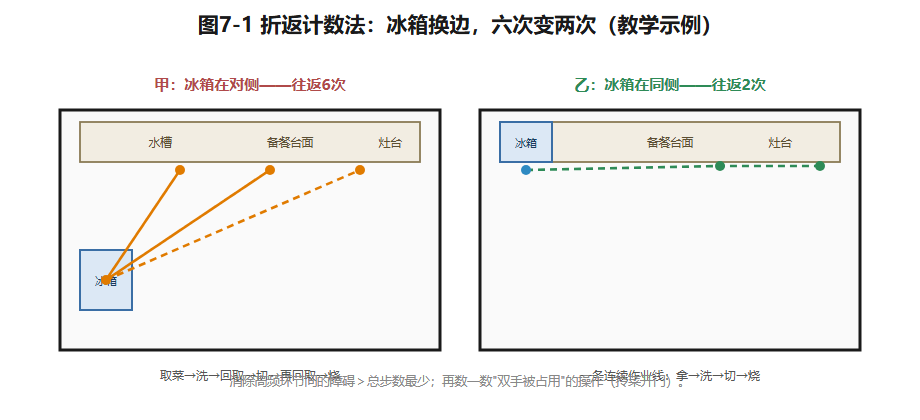
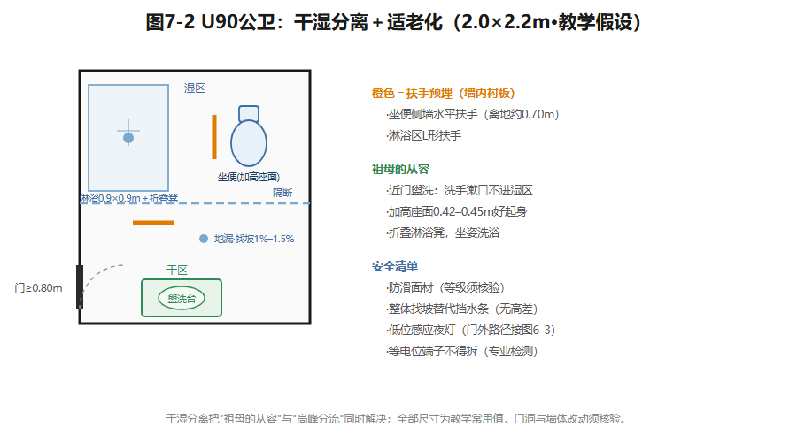

## 第7章 厨房、卫浴与家务空间

腊月二十九的下午，青枫里401的厨房进入一年中最忙的时刻。沈太太掌勺，沈先生进门放菜要洗鱼，祖母端着肉馅想找块台面——6.3㎡的厨房里，三个人不是被"面积"绊住的，是被"**作业面**"绊住的。

再看平常的早晨七点：沈先生占着坐便器，女儿急着刷牙，祖母排在门外——这回没有一块台面紧张，紧张的是"**同一分钟里有几件事必须同时发生**"。

两种拥挤，两种解法：备餐拥挤是作业面与通行的冲突，靠**工作流组织**解决；早高峰拥挤是功能同时占用的冲突，靠**功能分离**解决。厨卫与家务空间共享同一条分析线索：**行为链、尺度、管线的固定性**——本章就沿这条线走。

### 7.1 先看见"看不见的家务"

客厅待客、观影，是图上有沙发为证的"表演性活动"；而每天都在发生、却几乎从不出现在效果图里的，是家务劳动。把家务拆成链条看。

**食务链**：采购→储存→清洗→备餐→烹饪→就餐→清洁。每一环都要载体和场地：采购要落手处，储存要储柜冰箱，清洗要水槽沥水面，备餐要台面，烹饪要灶台排烟，清洁要垃圾与收纳位。**一环缺位，劳动就泄漏到别处**——没有落手处，菜袋就落在餐桌上。**衣物链**：洗衣→晾晒→熨烫→归置，横跨洗衣点、晾晒点、衣柜——三点越分散，穿越的房间越多。

为什么说家务"看不见"？因为它周期性、重复性发生，常由固定的一两位成员承担。设计若把家务空间当剩余空间——洗衣机塞走廊、拖把靠坐便器——粗糙不会消失，只会变成承担者**日复一日的身体与时间损耗**。台面够不够长、夜里去卫生间的路亮不亮，决定这份劳动的强度和尊严。

效率分析入门工具：**折返计数法**。做法：列一次典型任务（比如四菜一汤）的环节，标注到平面节点（冰箱、水槽、灶台、餐桌、垃圾桶），数往返和折返，标出"双手被占用"的操作（拎着菜开门），再找可合并的环节。教学示例（教学假设）：冰箱在操作区对侧，一顿晚餐往返六次；挪到同侧，降到两次。要点：**消除高频环节间的障碍，比追求总步数最少重要得多——每天十次的折返，胜过每年十次的绕路。**

*图7-1 冰箱换边：往返六次变两次——消除高频环节间的障碍比总步数更重要。教学示例。*

### 7.2 厨房：工作站、尺度与中餐的现实

**四个工作站。**厨房按"拿→洗→切→烧"排：储存（冰箱＋储柜）、清洗（水槽＋洗碗机）、准备（台面）、烹饪（灶台＋烤箱），相邻工作站共享边界。用工序效率研究厨房的学术传统始于1920年代的Gilbreth——工业心理学家与工程师，她的厨房动作改良研究是这一方向的公认起点（已核实线索：学术文献记述；人名年代以原典为准）；经典的**工作三角**连接冰箱、水槽、灶台，是其后被专业教材普及的通行工具（教学转述），教学常用值单边1.2–2.7米、总长4.0–6.6米。但**局限必须同时讲清**：三角只覆盖三站——现代厨房还有洗碗机、小家电区、烤箱；三角默认单人操作——多人协作时，三角让位于并行作业面与错身通道；一字型和岛式构不成三角，却未必不好用。**它是入门检查工具，不是设计目标。**

**布局四型**（教学常用值）：

| 型式 | 适用条件 | 教学常用最小尺寸 | 注意点 |
|---|---|---|---|
| 一字型 | 窄长、单面完整墙 | 台面总长≥2.4米；台前通道≥1.0–1.2米 | 动线折返多 |
| L型 | 两面相邻完整墙 | 两段总长≥2.7米、短段≥1.2米；台前净宽≥1.2米 | 转角柜配转篮 |
| U型 | 三面可用墙、面积充裕 | 开间进深均≥2.1米；两侧净距≥1.2米 | 净距不足转身难 |
| 岛式 | 开放半开放、面积充裕 | 岛台与主台间距≥1.0–1.2米；周边通道≥0.9米 | 岛设水槽涉改线 |

**操作台高度分区**（教学常用值，参照身高155–175厘米人群）：烹饪750–800毫米（端锅省力、视线越过锅沿）；准备800–850毫米（站姿肘下高度）；洗涤850–900毫米（补偿槽深、减少弯腰）。经验式：**基准台高≈身高÷2＋50毫米**。分区高度省力的代价是柜体复杂、台面不连续——小厨房常取单一高度或只抬高洗涤区。**没有免费的选择，只有被显式承认的交换。**

**储藏三级分区**（教学常用值）：**重物下柜**——米面粮油、锅具、清洁品，柜深550–600毫米，抽屉优于对开门（弯腰翻找变成抽出俯视）；**常用物**——调料、餐具、每日小家电，放台面附近与离地600–1600毫米取物带；**轻物吊柜**——干货、备用品，底距台面450–600毫米、深300–350毫米、顶不过2.2米。嵌入式烤箱宜入高柜"电器塔"中部（开口离地约0.6–1.0米），免去蹲俯——对天天烘焙的沈太太，这是每天的事。

**中餐烹饪与排油烟。**灶台、烟机与既有公共烟道的关系应优先核查；排烟管长度、弯折、门窗气流、烟机选型都会改变效果——**不能从平面位置直接推定性能**。U90把烟道和燃气立管列为固定项但未给设备角坐标；本章只立一条原则：尽量减少不必要的改管，请专业核验；安装高度与燃气做法以产品资料及现行要求为准。

**水电点位意识。**台面上方小家电带宜设3–5组带开关插座（教学常用值）；水槽下预留净水、垃圾处理器、洗碗机、厨宝的插座龙头位，洗碗机紧邻水槽；大功率回路须专业核验。点位贴砖后改动代价成倍——所以**点位先行：先设备清单，再点位，后饰面**。燃气另立规则：立管、表、阀归燃气企业管理，不可自行改管、不可封进无通风柜体（须核验）。对照U30全电无燃气设定：省了燃气约束，换来大功率电灶专用回路（须核验）；电炊仍有油烟，烟道固定项依旧。**燃气与电炊之别，连着真实的价值分歧**——火力习惯、能源结构、安全感知。

**U60暗厨房补偿。**U60厨房2.6×2.0，北内侧仅借天井高窗。通风以机械为主：高窗保持可开启、门下留进风百叶，让排风有定向补风而不是负压倒灌（须核验）。照度人工补足：一般照明＋柜底灯带消除操作者投影，高显色光源辨食材，浅色墙面提高反射（第8章展开）。**被动不足，主动补位。**

**开放厨房的社交性与油烟**，是一处真实的价值冲突。开放厨房让烹饪者走到家庭中心——沈太太能一边打发黄油一边照看女儿；但每日爆炒的油烟和噪声同样真实。折中是一个谱系：玻璃移门半开放、传菜口、中西厨分置（封闭中厨＋开放西厨岛台——恰配烘焙）。U90若想开传菜口，须先核验厨房临餐区墙段性质——若属固定项的承重墙段，此路不通。

### 7.3 卫生间：分离度谱系与安全底线

**分离度谱系。**如厕、盥洗、沐浴可合可分（面积为教学常用值）：

| 型式 | 构成 | 教学常用面积条件 | 适用家庭 |
|---|---|---|---|
| 一体式 | 三功能同室 | 约3.0–4.0㎡ | 单身、二人、低冲突 |
| 干湿分离 | 淋浴隔断，或盥洗外置 | 约3.5–5.0㎡（盥洗外置后湿区约2.5–3.5㎡） | 有儿童、两代、适老化 |
| 三分离 | 三者各自独立 | 约5.5–8.0㎡ | 四口以上、早高峰冲突高 |

分离的本质：**把互斥的同时使用拆开。**早晨七点一人刷牙、一人如厕、一人洗澡——一体式里是排队，三分离里是并行。分离度每上一级，都要面积与管线买单。

**洁具尺度与使用净空**（教学常用值）：

| 洁具 | 本体尺寸 | 使用净空 |
|---|---|---|
| 坐便器 | 宽0.36–0.40米、长0.70–0.75米 | 中心线距侧墙≥0.35–0.40米；前方≥0.60米 |
| 盥洗台（单盆） | 台面长0.80–1.00米、深0.52–0.60米 | 台前≥0.65米；双人并排≥1.4米 |
| 淋浴间 | 最小0.90×0.90米，1.00×1.00米较舒适 | 花洒高2.0–2.2米；门净宽≥0.60米 |
| 浴缸 | 外廓1.50–1.70×0.70–0.78米 | 跨入高0.40–0.50米，旁留扶手位 |
| 老人坐便 | 座面高约0.42–0.45米 | 两侧墙预留扶手位（横向约0.70米） |

为什么淋浴间0.9米见方是下限？来自身体包络：抱肘转身、弯腰拾物、举臂洗头，动作直径都在0.8米以上。

**安全四件事，须进设计文件。**①**防滑**：湿区通铺防滑面材（等级按产品标准核验），地面以1%–1.5%坡向地漏（教学常用值），适老化以整体找坡替代挡水条。②**扶手预留**：淋浴区L形扶手、坐便侧墙水平扶手（离地约0.70米，教学常用值）——关键在装修前期**墙内预埋加固板**。U90祖母68岁、膝盖不便、怕摔，公卫是她的就近卫生间，不预埋则日后补装代价高。③**夜间照明**：老人房至公卫路径设低位感应夜灯（公卫紧邻老人房以西，是户型库明示条件）。④**等电位联结**：卫生间通常设局部等电位端子，连通可能同时触及的金属导体以防电位差电击——**不得随意拆除**，检测改接须专业进行（须核验现行标准）。有儿童家庭另加热水恒温防烫与清洁剂上锁收纳。

**通风与采光。**暗卫的现实：无直接采光，靠人工照明补偿；通风必须机械——排风扇加止逆风阀，门下留进风百叶。异味控制还要查地漏与存水弯的水封是否有效、洗衣机排水是否正确接入（构造尺寸查现行标准和产品资料）。U60"天井高窗＋机械排风"是明暗之间的中间态；U90公卫直接采光有限（教学假设，以最终版图为准），按机械排风保底设计。

**U90两卫走两条路。**公卫2.0×2.2（4.4㎡）服务祖母、女儿与访客——矛盾是**祖母的从容＋高峰分流**，走"干湿分离＋适老化"：近门盥洗台（祖母洗手漱口不进湿区），往内坐便器与隔断淋浴间；清单——加高座面坐便、两处扶手预埋、折叠淋浴凳（座高0.42–0.45米，教学常用值）、防滑、无高差、门净宽按老人使用宜≥0.80米（门洞调整须先核验墙体）。主卫1.9×2.0（3.8㎡）只服务夫妇——矛盾是**早高峰并行**，走"效率型"：盥洗台近门，坐便器与淋浴间沿深处并列（0.9米淋浴间＋坐便位约1.65米，容于1.9米面宽，教学估算），湿区一道隔断；亦可盥洗台外移主卧衣帽区（新增点位与防水范围须专业核验）。**一个向安全冗余倾斜，一个向时间效率倾斜——同一套原理，因使用者而分岔。**

*图7-2 4.4㎡公卫：近门盥洗、内侧坐便与淋浴，扶手预埋点与找坡方向标注。教学假设，门洞改动须核验。*

### 7.4 家务区与生活阳台

**洗衣机位三选一**（教学分析）：

| 洗衣机位 | 得 | 失 | 适合情形 |
|---|---|---|---|
| 卫生间内 | 排水现成；更衣洗衣一条链 | 潮湿损电器；与如厕淋浴争地 | 卫间宽裕、洗浴同频 |
| 生活阳台 | 洗晾一步；检修方便 | 北方冬冻（防冻须核验）；暴晒褪色 | 南方；或有烘干互补 |
| 厨房/服务间 | 管线集中；动线合一 | 油烟沾衣；与烹饪冲突 | 西厨/家务间、轻烹饪 |

取舍不在"哪个最好"，在**洗衣行为**：谁洗、频率、单次量、有无烘干机。U90北生活阳台（1.2×2.25，2.7㎡，户型库数据）是参考解：洗烘叠放（占位约0.6×0.65米，教学常用值）靠外墙，旁设拖布池，顶部升降晾杆——洗、烘、晾在2.7㎡内闭环。但面宽只有1.2米：机器占0.65米后通道约0.55米，低于阳台家务通道教学常用值0.6米——**可用而不宽裕，这正是小户型家务空间的真实密度。**

**晾晒与烘干机的空间代价。**晾晒有气候的地方性：南方回南天，衣物一周不干还带霉味——烘干机在潮湿地区从改善型电器变成功能刚需；北方冬季户外冻结、冻干缓慢，室内晾衣增湿、挤占起居。烘干机的代价也是空间的：0.6米见方占地与开门空间、散热与专用电路（须核验）、叠放省地但取放口升高、要求承重减振。**晾晒还是烘干，本质是用阳台面积换时间与气候独立性**——因地域、户型、预算而异，没有全国统一答案。

**清洁工具收纳与"家务角"。**扫帚、拖把、吸尘器、清洁剂这类"长柄与零碎"最容易被忘在图纸上。原则：**集中、就近、立式悬挂**——一处水源与电源（拖布池、吸尘器充电位），近全屋重心，让扫除动线辐射最短。由此构成**家务角＝水源＋电源＋工具收纳＋垃圾暂存**的最小单元；U90由玄关（落尘）—厨房（清洁剂与垃圾）—北阳台（洗拖晾晒）连成一条家务带。另一个价值冲突：2.7㎡阳台上，**家务化与休闲化不可兼得**——把晾晒放在北生活阳台，是沈家已做出的选择；但它是选择，不是理所当然。

### 7.5 为什么"大挪位"有代价

初学者的常见冲动是重排厨卫：厨房挪南边采光好，卫生间扩成三分离。本节解释厨卫为什么最不该轻易动——**不是不许动，而是先看清代价。**

**四类条件限制厨卫重组。**U90把两处卫生间的降板区和排水走向、厨房烟道与管线列为固定项。排水立管、烟道、燃气设施的位置，决定设备布置的可讨论范围；改动可能牵动排水坡度、防水、排烟阻力、燃气安全与共用建筑设施——**这些都不能靠课堂平面图判定可行性。**正确姿势：先在既有位置优化使用顺序，再把必须改动的设备条件逐项交给专业核验。具体构造尺寸尚无项目资料，不能由"离管井近"推定符合要求。

**拆改的隐性账单。**厨卫拆改后，受扰动区域的**防水必须整体重做并做闭水试验**（须核验现行标准、专业施工）；回填、找坡、补砌、改管层层叠加——账单大头藏在饰面之下。一句直觉：**拆掉很容易，恢复的代价都看不见。**

**原则：能不改就不改，要改先问专业。**先用布局吸收约束——灶台就烟道、洁具就立管、洗衣就水源——把才智花在**每天受益**的尺度、流线与收纳上；确需改动时，转化为"待核验清单"：动什么、为什么、代价、由哪个专业核验（第11章发展成正式的技术待核清单）。

**例题：U90厨房——一字型还是L型？**净尺寸2.8×2.25米（教学假设），西北角，北窗，北接生活阳台。户型库只规定烟道、排水与燃气立管为固定项，**厨房门、阳台门、窗洞及设备角的精确位置尚未确定**——所以本例只能比较思路，不能给出已校验的摆位。**方案甲（一字型）**：清洗、准备、烹饪沿一面墙组织，减少转角与构造复杂度；需等烟道、立管、门窗的精确位置确定后，才知道该墙是否有足够连续长度；可能代价是备餐台面不足、冰箱取物往返。**方案乙（L型）**：利用相邻墙争取更长备餐面，但转角柜、冰箱、厨房门、阳台门可能争同一片空间；须在比例底图上标出每段台面与设备开启范围，检验最窄通道——**若净距不足，应判为待修改，不能因为台面变多就宣布优于甲。**分析：两案比的是连续作业面、操作与通行、设备管线、施工改动量。沈家烘焙频繁，备餐面值得争取——但不得以阻断厨房通行或违反固定管线为代价。

### 想一想

1.（选择）"一顿晚餐往返六次→两次"的改善，关键动作是——A. 换大冰箱；B. 把高频环节（冰箱）移到操作区同侧；C. 台面加长。
2.（选择）卫生间"等电位端子"的正确态度是——A. 装修时拆掉省地方；B. 不动它，检测改接找专业；C. 随便接线。
3.（简答）观察你家（或宿舍）的"看不见的家务"：哪一环的载体缺位，劳动泄漏到了哪里？用折返计数法数一次。

### 实践任务卡：约束下的厨卫布局（成果③c）

**任务**：U90厨房两方案＋公卫一方案，完成"约束下的布局"训练。
**要求**：①把食务链与如厕、盥洗、沐浴行为落到沈家四口＋祖母身上，标出高频与冲突行为；②待比例底图与设备坐标补发后，标出固定项（烟道、立管、降板区）绘制底图；③厨房两方案（一字型/L型各一版），标注台面分段、通道最窄处、点位与**烘焙停靠带**（沈太太的小家电清单：嵌入式烤箱、厨师机、破壁机、空气炸锅——教学假设）；④公卫一方案（干湿分离＋适老化），标注洁具净空与安全件位置，写明祖母就近如厕的行为依据；⑤对每版做"晚餐备餐"和"早晨七点"的折返计数，用数据比较；⑥安全要点清单（防滑、扶手、水封、燃气、防水），逐项标"教学常用值"或"须核验"。
**交互形式（线上实现，教材不绑定平台）**：厨房工作站拖拽＋工作三角自动连线与长度校验、折返计数器动画、早高峰多人体位冲突模拟。

### 本章小结

家务先被看见，才能被设计：食务链、衣物链环环有载体，一环缺位劳动就泄漏；厨房按"拿洗切烧"排工作站，工作三角是入门工具不是目标；卫生间讲分离度谱系与安全四件事（防滑、扶手预留、夜灯、等电位）；洗衣机位、晾晒与烘干、家务角都是行为决定的选择；厨卫大挪位的账单藏在饰面之下——能不改就不改，要改先问专业。

带走两句话：**每天十次的折返，胜过每年十次的绕路。拆掉很容易，恢复的代价都看不见。**

*（教学提示：本章学时、教师观察点与参考答案要点见配套《教师手册》。）*

---

*本章尾注·资料来源与核验记录*

| 素材 | 核验状态 | 来源 |
|---|---|---|
| 厨房工序效率研究始于1920年代Gilbreth | 已核实线索（学术文献记述） | 希腊克里特大学硕士论文文献综述等学术文本（2026-10检索）；人名年代细节以原典为准 |
| "工作三角"概念与常用数值 | 教学转述＋教学常用值 | 住宅室内设计专业教材通行工具（如Mitton《Residential Interior Design》可见同类表述）；数值为课堂推理值 |
| 本章全部尺寸（台面高度分区、布局四型、洁具净空、扶手高度等） | 教学常用值 | 本书课堂推理值；正式引用前逐项核验 |
| 燃气、防水、等电位、防滑等级、闭水试验等事项 | 须核验（查核入口） | 现行国家标准与地方规定；专业单位实施 |
| U90厨房/公卫尺寸、固定项设定 | 教学假设 | 本书户型库；精确门窗与设备角坐标待比例底图 |

> 网络来源仅用于核验与线索标注；规范只作查核入口，不转述条款数值。
