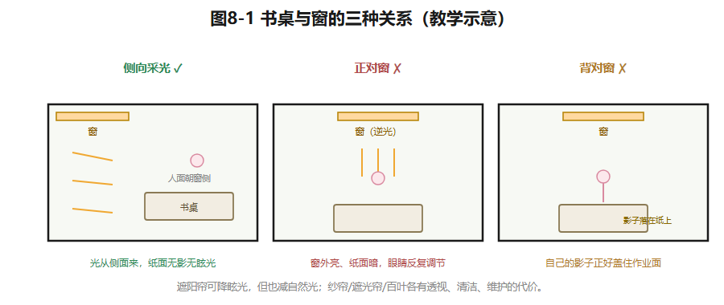
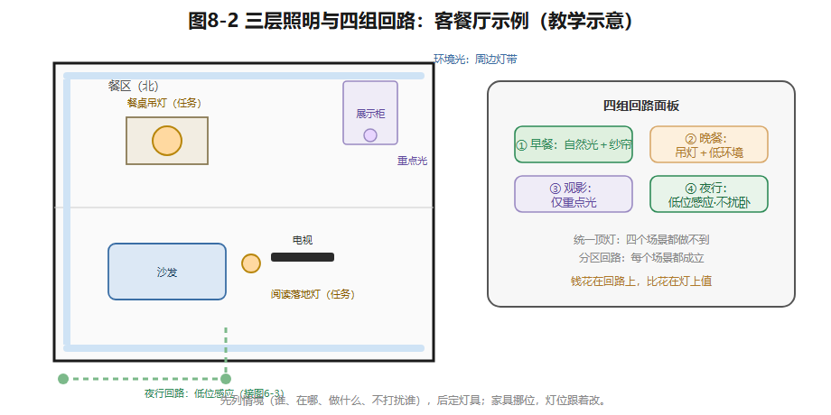

## 第8章 住宅采光与照明设计

沈家女儿的房间朝南。午后的阳光落在书桌上，照亮纸张——也可能从纸面反射进眼睛。书房朝北，光线安静均匀，可阴天下午四点就得开灯。

所以"朝南一定适合学习、朝北一定不好"，都不是设计结论。**光环境要连同时间、活动、开口和控制方式一起讨论**——这正是本章的做法。

### 8.1 光是给行为服务的

先问一个问题：这束光照亮的是**什么活动**？光帮人看清台面上的字和盘里的菜、认清夜里的路，也参与塑造空间的层次和生活的节律。所以室内光不能只用"够亮"一个词评价：同样的平均亮度，裸露灯泡会眩光；桌面很亮、四周漆黑，眼睛会累；卧室傍晚来个均匀大亮，恐怕没有人想睡觉。

设计者要分别记下：**视觉任务是什么、停留多久、使用者什么年龄、主观感受如何**，再决定灯位和可调范围。而且同一空间有不同的时刻——沈家客餐厅清晨靠自然光吃早餐，傍晚是晚餐加备课共用的房间，深夜要为祖母留一条低亮度的通路。这三种状态不是三张效果图，而是**光源、控制和家具位置的三组对应关系**。

### 8.2 自然采光：朝向只是第一层

南向开口，冬天有机会晒到太阳，夏天可能过热、直射眩光；北向光稳定柔和，但受季节和窗外遮挡影响。**朝向只是第一层条件**——窗的大小和高低、房间进深、邻楼遮挡、遮阳设施，才决定光实际走到哪里。U90客餐厅南北贯通，要检查的是**深处的餐区**在不同季节和时段能得到多少自然光——不能因为"有南窗"，就想象整个29.8㎡都均匀明亮。

自然光设计的步骤：①在平面图上标朝向与开口；②建立早/中/晚、晴/阴的使用情境；③标记直射区、反光面和需要人工补光的位置。儿童房南窗下若设书桌，比较三种朝向的差别：**侧向采光**（光从侧面来，最舒服）、正对窗（背光看字）、背对窗（影子落在纸上）；遮阳帘能降眩光，但也减了自然光。纱帘、遮光帘、可调百叶，各有透视、遮阳、清洁、维护的代价。要提醒的是：日照时数、照度与热性能的准确判断，需要当地气象数据、外部遮挡条件和经核验的计算模型——**本章的草图只是教学示意，不是照度计算**。（自然采光的规范评价用采光系数、窗地面积比等指标，查核入口《建筑采光设计标准》GB 50033，已核实现行2013年版；限值以现行文本为准，本书不转述。）

*图8-1 侧向采光/正对窗/背对窗：光从哪来，决定纸面上有没有影子和眩光。教学示意。*

### 8.3 人工照明：三层光，各司其职

人工照明分三层：**环境照明**建立整体可见度（你进屋开的第一盏灯）；**任务照明**服务于具体动作（阅读、切菜、化妆）；**重点照明**呈现物件或界面（一幅画、一面质感墙）。注意：**三层不是每个房间都买三盏灯**，而是按活动配光。

一个典型的例子：厨房台面被吊柜和操作者自己的身体挡住，顶灯再亮也照不到切菜的手——**在柜底补一条任务光，比增加顶灯数量有效得多**。餐桌上方灯的位置，应该跟着**选定的餐桌位置**走，不是跟着天花板的几何中心走。

各房间按活动建立**控制回路**：客厅从"日常交谈、会客、观影、夜间通行"四种活动出发；卧室要处理床头阅读与门口双控的关系；卫生间镜前灯避免从头顶直下——那会在脸上投下浓重的阴影（两侧补光才对）；书房要处理屏幕反光。祖母从东北角老人房到西侧公卫的夜路，要**从床边、房门、走道到卫门连续可辨**——用高亮度顶灯照这条路，会先吵醒全家。最后：不同年龄对亮度和眩光的承受力不同，**让家人试用，比"全宅统一色温"更有意义**。

*图8-2 客餐厅三层光位（环境/任务/重点）与四组回路面板对照。教学示意。*

### 8.4 从情境表到照明图纸

设计的顺序：**先列情境，后定灯具**。情境表写五件事：谁使用、活动位置、自然光条件、需要点亮哪些灯组、可能打扰谁。然后在家具平面图上标灯位、开关与控制关系。注意一个联动：把晚间备课从餐桌挪进书房，照明和插座就要跟着挪——**如果灯位按旧桌位配置，入住后体验就会失效**。（灯具功率、照度、眩光、潮湿区适用条件与电气回路，须依据产品和现行标准由专业人员核验。查核入口：《建筑照明设计标准》GB 50034，已核实现行国家标准；声光热环境基本要求另见强制性规范《建筑环境通用规范》GB 55016-2021，已核实名称可查；本书不转述条款。）

**示范例题**：为沈家客餐厅编"日常晚餐"和"祖母夜起"两行情境表。前者：餐桌可辨食物、起居区保留层次——点亮餐桌吊灯＋周边低亮环境光，**不开**沙发区重点光。后者：只需辨路、不照进儿童房——点亮走道低位感应灯＋公卫内小夜灯，**全屋主灯一律不开**。对比"一组统一顶灯"和"分区回路"两方案：统一顶灯两情境都无法满足；分区回路预算和控制复杂度略高，但每个场景都成立——**照明设计的钱，花在回路上比花在灯的豪华程度上值。**

### 想一想

1.（选择）厨房切菜看不清，最有效的对策是——A. 换更亮的顶灯；B. 吊柜底加任务灯带；C. 开着客厅灯。
2.（选择）"餐桌吊灯装在天花板正中央"的问题在于——A. 不美观；B. 灯位应跟餐桌位置走，餐桌不一定在正中央；C. 太亮。
3.（简答）写下你昨晚起夜（或摸黑找东西）的光路：哪里亮、哪里黑、最危险的一步在哪。

### 实践任务卡：U90光的四场景（成果④a）

**任务**：在成果②与③确定的家具位置上，完成U90照明方案。
**要求**：①朝向与时段分析图——三个教学假设时段（上午/午后/阴天傍晚）的采光范围标注，注明"教学示意，非照度计算"；②客餐厅四场景照明表（早餐/晚餐/观影/夜行）——每场景写明点亮哪组回路、亮度层次、不打扰谁；③祖母夜间路径示意图——从床到公卫分段光位（接第6章图6-3）；④"场景—家具—灯具"对应表一页；⑤家具布局若变，回改灯位。
**交互形式（线上实现，教材不绑定平台）**：时段太阳角滑块（早/中/晚直射区变化）、四场景开关面板点击模拟（灯组亮灭与层次）、夜起路径光效动画。

### 本章小结

光服务行为，不用"够亮"一个词打发；朝向只是第一层条件，窗、进深、遮挡、遮阳决定光走到哪；人工照明分环境、任务、重点三层——按活动配光，柜底任务光胜过加顶灯；先列情境表后定灯具，回路设计比灯具豪华更值钱；夜路要连续可辨又不惊醒全家。

带走两句话：**灯位跟着家具走，不跟着天花板走。照明的钱花在回路上，比花在灯上值。**

*（教学提示：本章学时、教师观察点与参考答案要点见配套《教师手册》。）*

---

*本章尾注·资料来源与核验记录*

| 素材 | 核验状态 | 来源 |
|---|---|---|
| 《建筑采光设计标准》GB 50033（2013年版）名称与现行 | 已核实线索 | 国标电子书库（中国建筑工业出版社，2026-10检索）；限值以现行文本为准 |
| 《建筑照明设计标准》GB 50034 名称与现行 | 已核实线索 | 通用规范条文解说引用（2026-10检索）；版本以最新公告为准 |
| 《建筑环境通用规范》GB 55016-2021 名称（强制性） | 已核实线索 | 规范目录与住建系统发布信息；实施细节以公告为准 |
| 采光系数、窗地面积比等术语 | 教学转述（标准术语） | 同上标准；具体数值本书不转述 |
| 本章时段采光示意、情境表法 | 教学原创方法 | 本书设计 |
| U90朝向与开口设定 | 教学假设 | 本书户型库 |

> 网络来源仅用于核验标注；规范只作查核入口，不转述条款数值。
