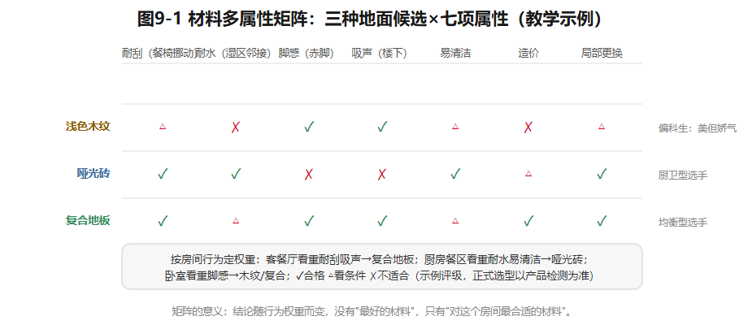
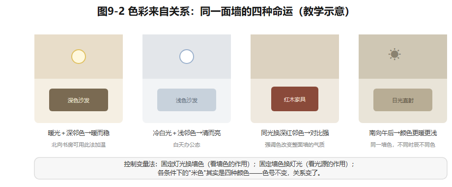

## 第9章 室内材料、色彩与空间氛围

同一间书房：浅色墙面加木质地面，显得明亮；深色墙面加厚织物，显得沉静。都好看——但住户每天在这里坐多久、怎么清洁、窗朝哪边，才决定哪种选择**适宜**。

材料和色彩不是给效果图"上色"。它们是人在空间里**接触、维护和感知**的界面——这一章教你用使用的眼光，而不是照片的眼光来选。

### 9.1 读一种材料，要读多种属性

材料可以同时从七个维度评价：**视觉、触觉、声学、耐久、清洁、造价、施工条件**。看似相同的两块"木纹"，可能是完全不同的构造和表面处理——摸上去不一样，怕不怕水不一样，坏了怎么修也不一样。数字贴图只能表达视觉意图，**不能推断真实产品的环保、防滑、防火、耐磨性能**——效果图里的"木地板"既不防水也不怕刮，因为它是像素做的。

分析沈家的地面，先问每个房间发生什么：客餐厅有餐椅反复挪动＋儿童游戏；厨房沾水沾油；卫生间赤脚湿行；卧室关心脚感和噪声。由此面对第一个选择：**统一铺装**视觉连续、好打理，但一种材料被迫承担全部性能要求；**分区选材**贴合行为，但多出收口、色差和维护的分界。每一种选择都要说清：满足了什么、牺牲了什么。

*图9-1 三种地面候选×七项属性：✓合格△看条件✗不适合；结论随房间行为权重而变。教学示例。*

### 9.2 界面设计：地、墙、顶各有脾气

地面、墙面、顶面是**触及频率不同的界面**。墙面不能只按远看的颜色选：玄关的墙会挨鞋包的撞，儿童房低处的墙会被摸和画，厨房的墙要经得起擦，卧室的墙更在乎触感和安静。顶面要过一道审查：**复杂吊顶若不能遮蔽设备、组织灯光或改善比例，就只是损失层高＋增加维护点**。（厨卫湿区防水、防滑、坡度和设备安装，须按项目与现行标准由专业人员核验——教学材料板不构成施工做法。材料健康与安全的查核入口：人造板甲醛释放限量见GB 18580，已核实2017年版2018年5月实施、限量收紧，限值以现行文本为准；建筑内部装修材料燃烧性能见《建筑内部装修设计防火规范》，现行版本号须核验；涂料、胶粘剂等各按对应现行标准核验。）

U90书房/老人房是双模式材料考题：平时办公，**椅轮**频繁碾压；祖母长住，**夜间步行、防滑、易清洁**变成第一性能。若用厚地毯换吸声，要同时检查绊倒风险、清洁负担和过敏因素——**不能让一个性能优势，遮住另一个使用者的风险**。

### 9.3 色彩来自关系，不来自色号

人对色彩的感知取决于：**相邻的颜色、光源、材质纹理、观察面积**。同一个米色，在北向阴天和南向午后是两个颜色；同一面墙，日光灯和暖光灯下是两种气氛。由此得到两个工具和一个提醒。

工具一：**北向房间用偏暖的材料和灯光增加主观温度感**——但暖色不能替代不足的任务照明。工具二：**小房间用低对比浅色降低界面的切割感**——但它不能自动扩大净宽，该放不下的床还是放不下。

提醒：可操作的方法是**先定大面积主色，再配辅助色，最后少量强调色**。大面积中性色便于随家具和家庭阶段变化，小面积强调色容易更换。但"浅色显大"不是法律——若沈家更重视傍晚安静的阅读氛围，书房用较深的墙色完全可能合理，**只要工作面照明和视觉识别不受损**。设计者要把审美偏好翻译成可说明的空间目标，而不是把心理感受说成某种颜色的必然功效。

*图9-2 同一面墙色在四种光与邻色条件下的对比；控制变量法找出感受变化的来源。教学示意。*

### 9.4 材料矩阵与预算取舍

给U90建**分房间材料表**，至少六列：使用行为、触感、耐久清洁、预算级别、可替代产品、**待核验性能**。预算紧张时的原则：**先保影响频繁活动和后期难改的**——基层处理和湿区工程；再谈随时间可调的——家具和装饰。**不能为了保留一块高价饰面，删去必要的技术复核。**

比较"明亮原木"与"沉稳对比"两套方案时，别把前者写成"一定温馨"、后者"一定高级"——那是不负责任的形容词。正确做法：在**同样的家具和照明条件**下比较——客厅白天和夜里的感受；儿童房耐不耐污、好不好擦；祖母夜里能不能看清地面高差；五年后家具换代，这套色彩还容不容得下变化。

**示范例题**：沈家客餐厅地面两版——A版全屋浅色木纹（视觉连续）；B版餐区换更耐清洁的材料、用收口条标识分区。比较四项：①餐椅挪动（A易留痕，B耐磨）；②清洁（餐区B占优，全屋A更省心）；③界面连续性（A优，B有收口条）；④维修（A需整片匹配，B可局部换）。再问一步：**若儿童游戏经常占用餐区**，耐刮需求的权重上升，B的胜算变大——结论随行为而变，这正是材料矩阵的意义。

### 想一想

1.（选择）效果图里的"大理石台面"不能证明的是——A. 视觉效果；B. 耐磨性能；C. 价格区间。
2.（选择）北向书房"用暖色补温度"的边界是——A. 暖色可以替代照明；B. 暖色只调节主观感受，任务照明另算；C. 北向必须用暖色。
3.（简答）你家有一处"好看但难用"的材料选择吗？用七属性说出它输在哪几项。

### 实践任务卡：两套材料色彩方案（成果④b）

**任务**：在U90已确认的空间与照明版本上，完成两套材料色彩方案。
**要求**：①分房间选型矩阵（六列齐全，含"待核验性能"）；②两套方案（如"明亮原木"vs"沉稳对比"）在**相同视点、相同光环境**下的对比示意——纸面样板或数字贴图均可，注明"贴图只表意图，不证性能"；③每方案至少三个非审美判断（触感/清洁/耐久）；④材料替代项（预算降档方案）；⑤300字以上方案比较——含"五年后家具换代"检验。
**交互形式（线上实现，教材不绑定平台）**：同一房间一键切换两套材料方案的对比视图、七属性雷达图点选、灯光条件滑块（观察色彩随光变化）。

### 本章小结

读材料读七种属性，贴图只表意图不证性能；地面按行为分区或统一，各有代价；墙面按触及频率选，吊顶要过"遮设备/组织灯光/改比例"三关；色彩来自相邻色、光源、纹理与面积的关系——先定主色再配辅助与强调；预算先保基层与湿区，别为饰面删技术复核。

带走两句话：**材料是用的，不是看的。色彩来自关系，不来自色号。**

*（教学提示：本章学时、教师观察点与参考答案要点见配套《教师手册》。）*

---

*本章尾注·资料来源与核验记录*

| 素材 | 核验状态 | 来源 |
|---|---|---|
| GB 18580《室内装饰装修材料 人造板及其制品中甲醛释放限量》：2017年版、2018-05-01实施、限量收紧 | 已核实线索 | 质检系统与检测行业发布信息（2026-10检索）；限值以现行文本为准 |
| 《建筑内部装修设计防火规范》现行版本与适用范围 | 须核验 | 规范名称通行；正式引用前查现行版本（GB 50222系列） |
| 材料多属性评价、材料矩阵法 | 教学原创方法 | 本书设计 |
| 色彩感受来自相邻色／光源／面积／纹理的关系 | 教学转述（色彩学通行原理） | 色彩学通行表述；未引入具体实验数据 |
| U90分房间材料情境 | 教学假设 | 本书户型库 |

> 网络来源仅用于核验标注；规范只作查核入口，不转述条款数值。
