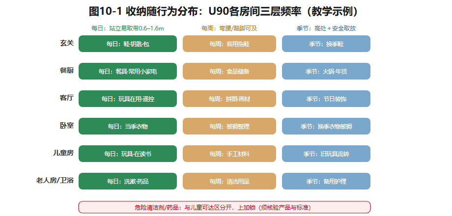

## 第10章 家具、收纳与空间利用

沈家入住第一年，玄关柜还有空位。女儿入学以后，书包、画材、换季的物件，一点点渗进客餐厅——当初被称为"宽敞"的留白，慢慢变成了堆物处。

收纳不足，常常不是"少买了一只柜子"这么简单：可能是**拿取距离太远**（柜在书房、人在餐桌），可能是**物品增长没被预见**（孩子入学是个拐点），也可能是**家具挡住通道**，柜子明明在，就是没法用。本章把家具和收纳当成空间设计的一部分来讲。

### 10.1 家具是一种空间构件

家具不只是"摆进去用的东西"——它**既支持动作，也建立界面**。你已经见过（第5章）：沙发和单椅相向，围出谈话区；沿墙一字排开，让出儿童游戏地面。高柜容量大，但遮光；矮柜区分起居与就餐，还保住视线。所以画家具图要画**两样东西**：实体＋使用包络——书桌不止占一张桌面，椅子还要后退；收纳柜不止柜体，抽屉还要拉开（第3章的复合尺寸，在这里全面回收）。

成品家具 vs 定制家具，也是一组空间决策：**成品**可替换、可搬迁，但未必贴边角；**定制**利用率高，却把生活方式固定下来、改造成本高。分配原则：**按房间未来变化的概率分**——儿童房把"容易成长的"（书桌椅）交给成品、"长期的"（柜体）交给定制；书房/老人房绝不能因为一整面定制书柜占满墙，而失去临时床位（双模式的底线又出现了）。

### 10.2 收纳跟着行为走

先按**使用位置**分类：玄关存外出物；餐厨存餐具、食品、小家电；卧室存衣物被褥；卫浴存日用品与清洁用品；儿童活动区存玩具和书。再按**使用频率**划层：**每日物品放在站立易取的位置**（约0.6–1.6米取物带）；季节物品可上高处，但要考虑怎么安全拿下来；**危险清洁剂与儿童可达区必须分开**。容量别只按当前物品统计——给家庭成长和设备更新留余量。

比"加柜"更有效的，是**"在哪使用、在哪收起"**。沈太太在餐桌备课，若资料柜只在书房，往返和餐前清台会天天发生；餐区一只浅柜或一个移动收纳盒，可能比一组昂贵的满墙柜更解决问题。还有一层取舍：**全封闭收纳**画面整齐，可家人的书、玩具、纪念物失去了"被看见"的位置；**开放展示**提高取用和归属感，代价是积灰和视觉杂乱。正确做法是把物件分三种：**需要隐藏的、需要展示的、需要每天搬动的**——三种各给去处。

*图10-1 U90各房间的"行为—物品—收纳"三层频率带，含危险品分区。教学示例。*

### 10.3 可变家具的真实成本

壁床、折叠餐桌、升降书桌，能让同一块面积在不同时间干不同的事——但**每次变形都要有人亲手完成**。如果每天夜里都要挪柜、翻床、铺被，所谓"节约面积"，其实是**用重复劳动支付的**。

判断一个多功能家具，记五件事：**默认状态、切换频率、每次操作动作、物品收纳去向、一人能否安全完成**。对膝盖不便的祖母，固定床占面积，却免去了每晚调整的负担；对偶尔来访的客人，折叠床可能正合适。同一件家具，对不同的人，成本完全不同。

### 10.4 小户型的四种空间资源

U30单身公寓约30㎡，要装下睡眠、插画工作、就餐、起居。小户型的本钱有四种：

1. **时间**——哪些行为不同时发生？睡觉时不需要客厅，工作时不需要餐桌（错峰复用同一面积）；
2. **高度**——3.9米教学假设层高给了垂直收纳的想象空间；但**夹层能否建造必须核验**结构、净高、疏散、产权与地方规定——画一层"空中卧室"不等于能施工；
3. **界面**——轻隔断和柜体既划区又储物，但可能遮断南向唯一的采光；
4. **视线**——从入口到窗保持视觉连续能改善空间感，但**不会改变实际通行净宽**。

U60紧凑两居的难题是另一种：年轻夫妇现在把次卧当书房，计划生育后要变儿童房——**预留电位、柜体分段、家具可替换，比把每一厘米塞满更有长期价值**。一句话：小户型优化不是让物件数量最大，而是在**日常使用、转换成本、长期适应**之间找到可解释的组合。

> **图10-2 小户型四种资源**：U30平面示意——时间轴错峰复用、高度剖面（夹层须核验标注）、界面柜体双用、入口到窗视线通廊，四个小图各讲一种资源。

### 10.5 从家具清单到实施顺序

家具计划表记五项：**规格来源、目标尺寸、适用活动、预算区间、运输条件**。特别提醒最后一项：大沙发在图上放得下，还要**核入户门、楼梯、电梯和转角**——图纸不量楼道。实施顺序上，先定**与建筑界面紧密耦合的**（定制柜体、灯位、插座），再定**易更换的陈设**——返工最少。

**示范例题**：U30插画师想保住1.6米工作桌、完整床、四人餐桌。做"工作优先"与"待客优先"两版：记录家具变换次数、南窗采光怎么分、物品放哪。然后回答那个刺人的问题：**若待客一个月只发生一次，长期牺牲工作位合理吗？**——用第6章的"默认模式"逻辑裁决。

### 想一想

1.（选择）"柜子够大却总觉得乱"最可能的原因是——A. 柜子不够高；B. 收纳没跟着使用位置走；C. 颜色不对。
2.（选择）壁床"节约面积"的真实账本是——A. 纯赚；B. 面积换劳动，切换频率决定值不值；C. 一律不值。
3.（简答）用"隐藏/展示/每天搬动"三分类，盘点你桌面或床头的一堆东西，各该去哪？

### 实践任务卡：家具与分区收纳计划（成果④c）

**任务**：为U90编制家具与分区收纳计划；或任选U30/U60做小户型优化。
**要求**：①家具计划表（五列齐全＋运输条件核对）；②收纳分布图——按"行为—位置—频率"三层标注，含危险品分区；③注明沈家当前需求与情境B五年后的新增需求（学习角、老人常住）；④可变家具用"五要素"评估（默认状态/切换频率/操作动作/收纳去向/能否独立完成）；⑤与第8章灯位、第9章材料表做一致性检查；⑥U30/U60方案做"默认状态—转换状态"对照两张。
**交互形式（线上实现，教材不绑定平台）**：家具拖拽＋包络自动显示、收纳容量计算器（按物品类别）、时间轴错峰复用动画、夹层净高模拟（标注须核验）。

### 本章小结

家具是空间构件，画实体也画包络；成品与定制按"未来变化概率"分配；收纳跟着行为走——在哪使用、在哪收起，比加柜进深有效；物件分隐藏/展示/每天搬动三类；可变家具的真实成本是劳动，五要素评估；小户型四种资源——时间、高度、界面、视线，夹层可建性须核验。

带走两句话：**在哪使用，就在哪收起。节约的面积，是用重复劳动支付的。**

*（教学提示：本章学时、教师观察点与参考答案要点见配套《教师手册》。）*

---

*本章尾注·资料来源与核验记录*

| 素材 | 核验状态 | 来源 |
|---|---|---|
| 家具作为空间构件、收纳随行为分布、可变家具评估五要素 | 教学原创方法 | 本书设计 |
| U30夹层设想（3.9m层高教学假设） | 教学假设；可建性须核验 | 本书户型库；结构、净高、疏散、产权及地方规定须专业核验 |
| U30/U60/U90家庭与家具设定 | 教学假设 | 本书户型库 |
| 大件家具运输通道核对（入户门、楼梯、电梯） | 教学转述（行业通行做法） | 家具业通行交付核对流程 |

> 本章无外部事实主张；规范事项均以"须核验"标注。
