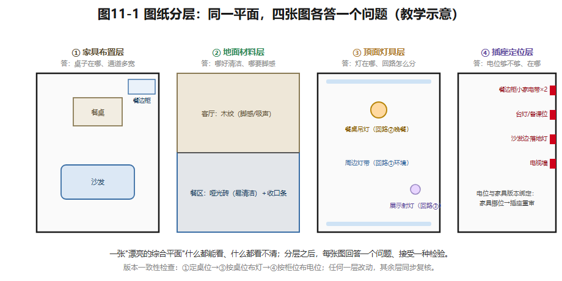

## 第11章 住宅设计技术与表达

沈家想把儿童房与书房的隔墙改成更灵活的界面，有人顺口提议：把主卧旁边那段墙也拆了，起居区更宽敞。一张效果图可以同时画出这两种做法——却**不能告诉你两段墙的结构性质**。

设计师必须先看原建筑资料：哪些是课程设定可变的非承重隔墙，哪些是碰不得的剪力墙。**技术判断不因美观需求而自动改变**——这就是本章的主题：技术底线、图纸语言、版本管理。

### 11.1 方案背后的工程系统

室内设计不是画完就结束的，它和**结构、给排水、电气、暖通、燃气、防水、施工工艺**连成一张网。移一个坐便器，牵动排水路径和防水；换一扇窗，牵动外立面和产品安装；厨房添个大功率电器，牵动电路容量。课程要求你**识别这些接口**——不是要你替代结构工程师、燃气单位或施工监理。

拿U90演练一遍改造的思考顺序：**读取既有图纸与现场条件 → 标出固定/可变 → 提出空间策略 → 列专业待核问题 → 据结论深化。**注意是"先读后拆"，不是"先拆后补资料"。U90的固定项再背一遍：外墙门窗、入户门、两道剪力墙、厨房烟道与立管、两处卫生间降板区；儿童房与书房之间一段非承重隔墙是教学可变项——即使调它，也要重新检查两个房间的门、采光、家具和走道净空。

### 11.2 技术提醒不是规范审核

有些问题**图面上就能确定**：门扇撞不撞家具、方案和固定项图一致不一致——直接看。有些问题**必须实测**：现状墙体厚度、地面高差、入户门实际净宽——去现场量。有些问题**必须专业复核**：结构拆改、燃气移位、防水构造、电气容量——交出去。（涉及通用规范时，GB 55019-2021无障碍、GB 55037-2022建筑防火、GB 55031-2022民用建筑可作查核入口，三者均为强制性工程建设规范，已核实线索；条款适用须核实版本、建筑类别与具体内容。）一句红线：**教材写出一个数字，不等于取得了工程合规审查资格；"待核验"永远不能被改写成"已达标"。**

把技术疑点记成**三层清单**，每项记五栏：问题、影响、所需证据、责任专业、当前状态。这张表就是设计与专业协作之间的接口文件。

### 11.3 图纸：让设计接受检验的语言

住宅方案至少要有：**比例平面、功能与动线分析、关键立面或剖面、材料与灯具说明**。平面图要**分层**表达：家具布置层、地面铺装层、顶面灯具与控制层；立面说明柜体高度、门缝、设备位置；剖面帮人理解吊顶、地面材料交接、柜体固定方式。**不同的图纸回答不同的问题**——效果图传达氛围，却不能代替净距和设备定位。

以U90客餐厅为例，分层怎么落：**家具布置图**定餐桌位置；**顶面图**按桌位布灯（第8章的联动）；**插座定位图**回应餐边柜和备课位；**地面材料图**处理餐区清洁与客厅触感（第9章的联动）；**一处餐边柜立面**标出收纳分格和小家电电位。如果只画一张"漂亮的综合平面"，施工和专业复核时**每种信息都读不清**。

*图11-1 同一U90客餐厅的四个图层与各自回答的问题；版本一致性随层联动。教学示意。*

### 11.4 版本与可追溯的论证

设计评议要**同时保留**：初始条件、方案A、反馈、方案B、修改理由。两个常见的失配：图纸已改餐桌位置，照明图还按旧版出图（灯位跟着家具走——第8章的承诺，这里兑现）；或者甩出一个没有解释的总分宣布"B更好"。**自动几何检查**最多说明物件交叠、越界、字段完整这类可观察事实；体验、审美、施工可行性、规范适用，仍需要有人负责判断——别让"AI专家分"替人签字。

专业协作的关键动作：**把图纸版本与待核事项绑定**。若结构复核否决了那段隔墙的调整，你要能立刻追溯"哪些局部设计依赖这个假设"，快速回退而不丢此前方案。版本管理不是软件行业的专利——**它是减少设计信息失配的基本工作方法**。

**示范例题**：某U90学生方案干了三件事——①在剪力墙一上新开洞；②把祖母房挪到远离公卫的位置；③在未确认墙体条件时标注扶手。请归类：①**违反教学固定条件**（硬伤）；②**需要解释的生活取舍**（要给出理由：为什么牺牲就近如厕）；③**必须专业复核的节点**（扶手承载要看墙体）。若只看平面效果，三件事可能一件都发现不了——**好看不是证据**。

### 想一想

1.（选择）"燃气表想移到柜子里藏起来"属于——A. 图面可确定；B. 待实测；C. 必须专业复核（且不可封入无通风柜体）。
2.（选择）效果图最大的局限是——A. 不够好看；B. 不能传达氛围；C. 不能代替净距与设备定位的检验。
3.（简答）找一份你家的户型图（或宿舍平面），列出三个"图面可确定"和三个"须实测"的问题。

### 实践任务卡：分层图纸与技术待核表（阶段五前半）

**任务**：把U90选定方案深化为可检验的图纸包，作为第12章最终作品包的技术层。
**要求**：①图纸目录＋分层比例平面（家具/地面/顶面/插座至少四层）；②至少一处关键立面或剖面（如餐边柜立面：收纳分格＋电位）；③A/B版本差异表（改了什么、为什么、谁反馈的）；④技术待核事项表**至少八项**，五栏齐全（问题/影响/证据/责任专业/状态）；⑤与成果①–④逐项对齐检查。
**交互形式（线上实现，教材不绑定平台）**：图层开关切换浏览、版本对比高亮差异、待核事项表单化提交与责任专业自动分类。

### 本章小结

技术底线：先读后拆，固定项不可动，"待核验"不能变"已达标"；疑点分三层——图面可确定/待实测/待专业复核，记成五栏清单；图纸是接受检验的语言，分层表达，不同图回答不同问题；版本与待核事项绑定，能追溯、能回退。

带走两句话：**技术判断不因美观需求而改变。好看不是证据。**

*（教学提示：本章学时、教师观察点与参考答案要点见配套《教师手册》。）*

---

*本章尾注·资料来源与核验记录*

| 素材 | 核验状态 | 来源 |
|---|---|---|
| GB 55019-2021《建筑与市政工程无障碍通用规范》 | 已核实线索 | 住建部公告（见第2章来源记录） |
| GB 55037-2022《建筑防火通用规范》 | 已核实（住建部公告，中国政府网转载；2023年发布） | 住房和城乡建设部公告页；gov.cn 政策文件库（2026-10检索） |
| GB 55031-2022《民用建筑通用规范》 | 已核实线索 | 住建部公告（见第3章来源记录） |
| 三层技术疑点分类法、版本绑定待核事项 | 教学原创方法 | 本书设计 |
| U90固定项/可变项设定 | 教学假设 | 本书户型库；真实项目以原建筑图纸与专业核验为准 |

> 规范只作查核入口；本教材不输出工程合规结论。
