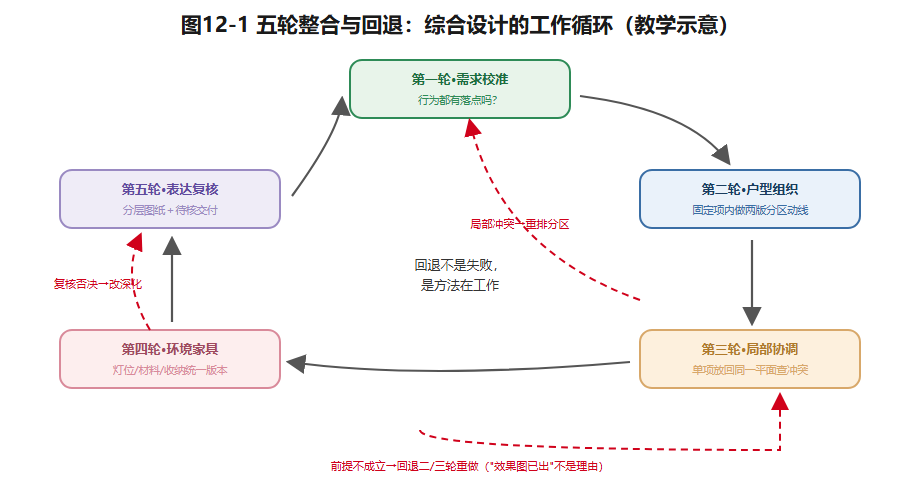

## 第12章 住宅室内综合设计

沈家住宅的客餐厅、卧室、厨房，分别都推敲过了，每个单项方案看起来都成立。把它们放进同一张平面，问题才集中爆发：**餐边柜挤占厨房门前通道；老人房的夜间路径被新增储物柜打断；起居区吊灯和最终确定的餐桌位置错开了。**

所以综合设计不是把前十一章的图纸装订起来——而是**重新检查这些判断，能否在同一套住宅、同一组住户、同一笔预算和同一批固定约束中同时成立**。这是全书最后一章，也是把"各章都学过"变成"一个完整设计"的一章。

### 12.1 把分散的成果整合为一个命题

综合项目以U90「青枫里401」及沈家情境A为基准（可选情境B做第二版本比较）。项目条件、房间尺寸、固定项、家庭成员资料，一律以《住宅贯穿案例与户型库》为准——它不是真实楼盘的工程委托。

从第2章的需求档案里，提取**三项决定性的居住矛盾**。例如：居家办公与老人临住争用书房；女儿成长与房间固定装修冲突；餐桌承担就餐＋晚间备课双任务。每项矛盾对应**一项空间策略及其代价**——书房双模式提升使用效率，却可能牺牲稳定的办公环境；儿童房预留成长弹性，就要接受近期收纳压力。任务书必须写出**方案暂不解决的问题**：不能把全部需求包装成"无冲突"的宣传语。诚实，是设计论证的第一步。

### 12.2 五轮整合与回退

综合设计按五轮推进，**每一轮都可能触发回退**——回退不是失败，是这套方法在工作。

**第一轮·需求校准。**复核家庭画像、行为日志与需求矩阵：沈先生每周约两天居家办公、沈太太晚间备课、祖母季节性长住——这些行为在平面上有明确落点吗？若情境改为"祖母常住"，哪些空间必须重算？

**第二轮·户型组织。**在不可改的外墙、剪力墙、厨卫降板与管线位置之内，提交两版功能分区与动线图。比较的不只是走道长短：老人房到公卫的夜间路径、厨房到餐区的家务路径、访客进起居区是否要越过卧室门前。**固定条件不会因为一句"拆墙扩大空间"而消失。**

**第三轮·局部空间协调。**把客餐厅、卧室书房、厨卫的设计放回同一版平面。检查：餐桌拉椅是否侵入主通道；书房转老人房后还剩多少储物；厨房新增烘焙设备有没有吃掉连续备餐台面；公卫干湿分离是否妨碍祖母夜间进入。**局部最优不能自动叠加成整体最优。**

**第四轮·环境与家具深化。**在选定平面上统一：灯位与家具位置（第8章的联动承诺）、材料与清洁维护（第9章）、收纳容量与成长预留（第10章）。材料样板不是视觉拼贴——厨房台面、儿童房墙面、卫生间地面各有触感、清洁、耐久与安全的账。线上光影示意若未经专业光度计算，**不得写成准确照度结论**。

**第五轮·表达与复核。**完成分层图纸、关键立面/剖面、版本比较、待核事项表（第11章）。需要结构、机电、燃气、防水专业确认的事项**明确交付出去**，不用漂亮的渲染图掩盖不确定性。若复核发现关键前提不成立——**回退到第二或第三轮重做**；"效果图已经出了"不是保留方案的理由。

*图12-1 需求校准→户型组织→局部协调→环境家具→表达复核的工作循环，红色虚线为回退路径。教学示意。*

### 12.3 完整作品包

| 作品项 | 最低交付 | 证明的问题 |
|---|---|---|
| 居住需求档案 | 家庭画像、行为日志、需求矩阵、任务书 | 谁使用、何时使用、什么最优先 |
| 场地与约束图 | U90固定项/可变项标记、待核事项清单 | 哪些决策在设计权限内 |
| 空间组织 | 功能关系图、两版分区平面、主次动线图 | 为什么这一版优于替代方案 |
| 局部设计 | 客餐厅、卧室书房、厨卫各至少一处关键局部图 | 具体活动是否得到支持 |
| 环境与陈设 | 日夜照明方案、材料色彩板、家具与收纳清单 | 体验如何落地、怎样维护 |
| 图纸表达 | 比例平面、至少一处立面或剖面、关键节点意向 | 设计信息能否被他人复核 |
| 过程记录 | A/B版本与取舍理由、反馈后修改记录 | 是否存在真实的设计迭代 |
| 最终论证 | 不少于600字设计说明或等效答辩文字稿 | 成果、局限与风险能否说清 |

所有成果使用**同一个版本编号**：图纸、材料表、设计说明必须对应同一版平面；家具挪了位，灯位、插座、通道要同时复查（第11章的版本绑定）。纸面图、CAD、数字工具都可以交付——**但软件熟练度不能替代设计论证**。

### 12.4 评价与答辩

| 维度 | 分值 | 教师判断重点 |
|---|---:|---|
| 需求研究与证据 | 20 | 居住问题是否从行为与访谈材料中合理推得 |
| 户型与局部空间组织 | 25 | 分区、通行、各成员的利益与冲突是否说得清 |
| 居住体验与表达 | 20 | 光、材料、家具与图纸是否形成连贯意图 |
| 约束与可实施性 | 15 | 固定项是否被尊重，待核事项是否诚实标注 |
| 过程与迭代 | 20 | 替代方案比较、反馈吸收与反思是否有证据 |
| **合计** | **100** | 自动几何反馈只作辅助证据，不单独判定品质或合规 |

答辩不只问"为什么选这个方案"，还要问：**"如果祖母转为常住，这个方案先在哪里失效？""你放弃了哪个看似有吸引力的方案，依据是什么？"**可以选择U30、U60或U120做附加对照，展示同一原理随面积、家庭结构、技术条件怎样改变——对照不是再做一套毕业设计，而是证明**迁移能力**。

课程最后一问留给使用之后：**使用后评估**——入住半年，当初的判断哪些成立、哪些失效？（这超出课程周期，但一个好的设计者会在心里留着这个问题。）

### 想一想

1.（选择）"每个房间的方案都很好，拼在一起出问题"最恰当的叫法是——A. 风格不统一；B. 局部最优不能自动叠加为整体最优；C. 图纸画错了。
2.（选择）复核发现隔墙假设不成立，正确动作是——A. 保留方案因为效果图已出；B. 回退到第二/三轮重做受影响部分；C. 只改文字说明。
3.（简答）用"三项矛盾＋代价"的格式，给你自己的宿舍或家写一份迷你任务书（矛盾写清，暂不解决的也写上）。

### 实践任务卡：完整住宅项目与答辩（最终作品包）

**任务**：汇总成果①—④与第11章技术表达，在U90完成最终作品包、版本比较与答辩。
**要求**：①任务书——三项居住矛盾＋策略＋代价＋"暂不解决的问题"；②五轮过程记录（含至少一次真实回退或同伴"住户试走"评议后的修改证据）；③作品包八项齐全（见12.3表），统一版本编号；④技术待核事项表与专业交付清单；⑤600字以上设计说明或答辩稿——说清成果、局限、风险；⑥可选U30/U60/U120对照分析。
**交互形式（线上实现，教材不绑定平台）**：作品包版本树可视化、五轮关卡自动检查单、答辩计时与提问抽签、同伴试走评议表单。

### 本章小结

综合设计是把单项判断放回同一套住宅、同一组住户、同一批约束里重新检验；任务书写出三项矛盾与代价，也写出暂不解决的问题；五轮整合（需求→户型→局部→环境→表达）每一轮都可能回退——回退是方法在工作，不是失败；作品包八项用同一版本编号，评价五维里"过程与迭代"占二十分；答辩要能回答"方案先在哪里失效"。

带走两句话：**局部最优不能自动叠加成整体最优。效果图已经出了，不是保留方案的理由。**

*（教学提示：本章学时、教师观察点与参考答案要点见配套《教师手册》。）*

---

*本章尾注·资料来源与核验记录*

| 素材 | 核验状态 | 来源 |
|---|---|---|
| 五轮整合与回退、作品包与评价框架 | 教学原创方法 | 本书设计 |
| U90项目条件、家庭与户型设定 | 教学假设 | 《住宅贯穿案例与户型库》（配套文件） |
| 评价维度与分值 | 教学建议 | 本书设计；任课教师可调整 |

> 本章无外部事实主张；项目条件一律以《住宅贯穿案例与户型库》教学假设为准。全书核验体系统见附录D与各章末"资料来源与核验记录"。
